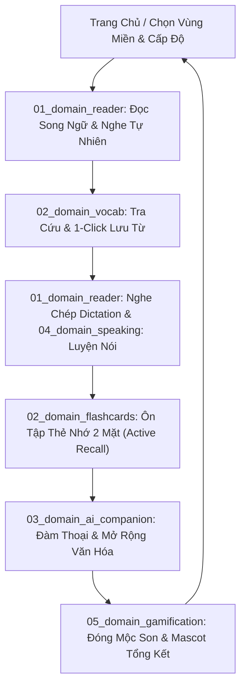

# 🔄 [Interface Core] Chu Trình Học Tập Tích Hợp (Integrated Learning Loop)

> **Kế thừa từ:** Triết lý sản phẩm VieCultures  
> **Tham chiếu hằng số:** [`system_constants.md`](./system_constants.md)  
> **Các domain triển khai:** `01_domain_reader`, `02_domain_vocab_flashcards`, `03_domain_ai_companion`, `04_domain_speaking_voice`, `05_domain_gamification`

---

## 1. Mục Đích & Ranh Giới Trách Nhiệm (Core Responsibilities)

`interface_learning_loop` đóng vai trò là xương sống kiến trúc (Architectural Backbone) kết nối tất cả các Domain tính năng thành một chu trình khép kín, đưa người học từ tiếp thu thụ động (*Reading*) sang thực hành chủ động (*Dictation, Speaking, Recall, Conversation*).

---

## 2. Các Bước Cốt Lõi Trong Chu Trình (The 7-Step Lifecycle Contract)

| Bước | Tên Giai Đoạn | Domain Đảm Nhiệm | Hợp Đồng Dữ Liệu Đầu Vào / Đầu Ra | Điều Kiện Chuyển Bước |
| :--- | :--- | :--- | :--- | :--- |
| **Step 1** | **Discovery** | `00_core` | User chọn `region`, `topic`, `level` (từ `system_constants.md`) | Chọn 1 bài học hợp lệ |
| **Step 2** | **Bilingual Reading** | `01_domain_reader` | Input: `ParagraphPair[]`, `audio_url` đa tốc độ (`1x`, `0.8x`, `0.5x`) | Đọc & tương tác bài đọc |
| **Step 3** | **Vocab Extraction** | `02_domain_vocab` | Input: Highlighted words. Output: `SavedVocab` bắt buộc kèm `context_sentence` | Người dùng bấm "Lưu từ" |
| **Step 4** | **Practice (Dictation / Speaking)**| `01_domain_reader` & `04_domain_speaking` | Input: Câu audio mốc thời gian. Output: Realtime matching / Voice input | Thực hành câu ít nhất 1 lần |
| **Step 5** | **Flashcard Active Recall**| `02_domain_flashcards` | Input: Danh sách từ của bài học. Output: Đánh giá nhị phân 🟢/🔴 | Hoàn tất lật và đánh giá các thẻ |
| **Step 6** | **AI Conversation (Tùy chọn)**| `03_domain_ai_companion` | Input: Gemini API Key + Prompt bài học. Output: Cultural Summary / Q&A | Người dùng đóng chatbox |
| **Step 7** | **Wrap-up & Recognition**| `05_domain_gamification` | Input: Thống kê phiên học. Output: Mộc son văn hóa + Điểm Streak | Cập nhật hồ sơ cá nhân |

---

## 3. Quy Tắc Hoàn Thành Phiên Học (Completion Contract)

1. **Điều kiện hoàn thành tối thiểu (Core Minimum Requirement):**
   - Hoàn thành Bước 2 (Đọc & nghe audio bài học).
   - Hoàn thành Bước 5 (Lật và đánh giá nhị phân toàn bộ từ vựng flashcard của bài).
2. **Các bước thực hành mở rộng (Optional Enrichment):**
   - Dictation (Bước 4), Luyện nói (Bước 4) và AI Companion (Bước 6) là tùy chọn tăng cường, không chặn việc mở khóa bài tiếp theo.
