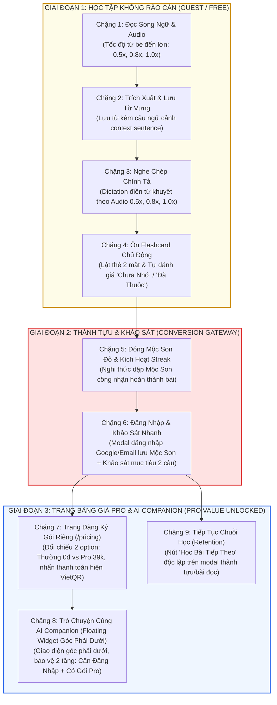

# 🔄 [Interface Core] Chu Trình Học Tập Tích Hợp (Integrated Learning Loop)

> **Kế thừa từ:** Triết lý sản phẩm VieCultures  
> **Tham chiếu hằng số:** [`system_constants.md`](./system_constants.md)  
> **Các domain triển khai:** `01_domain_reader`, `02_domain_vocab_flashcards`, `03_domain_ai_companion`, `04_domain_speaking_voice`, `05_domain_gamification`

---

## 1. Mục Đích & Ranh Giới Trách Nhiệm (Core Responsibilities)

`interface_learning_loop` đóng vai trò là xương sống kiến trúc (Architectural Backbone) kết nối tất cả các Domain tính năng thành một chu trình khép kín, đưa người học từ tiếp thu thụ động (*Reading*) sang thực hành chủ động (*Dictation, Recall*), tích lũy thành tựu (*Gamification*), chuyển đổi kinh doanh (*Auth & Pro Subscription*) và trải nghiệm nâng cao (*AI Cultural Companion*).

Tài liệu này chuẩn hóa **Luồng Chính Toàn Diện Của Sản Phẩm (End-to-End Product Main Flow)** – phản ánh đúng bản chất sản phẩm Startup công nghệ giáo dục (EdTech Startup) kết hợp hài hòa giữa **Giá trị học tập (Learning Value)** và **Chuyển đổi kinh doanh (Monetization & Retention)**.

---

## 2. Luồng Chính Sản Phẩm (The End-to-End Product Main Flow)

Luồng chính của VieCultures được thiết kế theo 6 chặng liên hoàn, kết hợp giữa trải nghiệm không rào cản (Frictionless Learning), chốt chuyển đổi sau thành tựu (Achievement-Gated Auth & Monetization), và mở khóa giá trị cao cấp (AI Companion):

---

### Bảng Đặc Tả Chi Tiết Các Chặng Trong Luồng Chính:

| Giai Đoạn | Chặng | Tên Chặng & Domain | Trải Nghiệm Cốt Lõi | Dữ Liệu Vào / Ra | Tiêu Chí Hoàn Thành |
| :--- | :--- | :--- | :--- | :--- | :--- |
| **I. Học tập** | **Chặng 1** | **Đọc Song Ngữ & Nghe Tự Nhiên** `01_domain_reader` | • Đọc các cặp đoạn Anh – Việt đối chiếu 1:1 theo Level. • Sticky Audio Player phát với tốc độ từ bé đến lớn (`0.5x`, `0.8x`, `1.0x`). | **In:** `ParagraphPair[]`, `audio_url` **Out:** Vị trí audio, index đoạn | Nghe/đọc tối thiểu 50% hoặc xem hết các đoạn. |
| | **Chặng 2** | **Trích Xuất & Lưu Từ Vựng** `02_domain_vocab_flashcards` | • Bấm từ highlight hổ phách xem tooltip định nghĩa. • Nút Lưu từ vào sổ tay (tự động ghim `context_sentence`). | **In:** Click event từ đoạn văn **Out:** `SavedVocab` | Lưu tối thiểu 1 từ hoặc xác nhận đã nắm từ mới. |
| | **Chặng 3** | **Nghe Chép Chính Tả (Dictation)** `01_domain_reader` | • Nghe audio câu trích từ bài học ở các tốc độ (`0.5x`, `0.8x`, `1.0x`). • Gõ điền từ khóa văn hóa còn thiếu vào ô trống, nhận feedback đúng/sai tức thì. | **In:** Audio câu khuyết từ **Out:** Điểm số chính xác (%) | Hoàn thành tối thiểu 1 câu dictation. |
| | **Chặng 4** | **Ôn Tập Thẻ Nhớ (Active Recall)** `02_domain_vocab_flashcards` | • Thẻ nhớ 2 mặt (Mặt trước: từ + ngữ cảnh; Mặt sau: IPA + nghĩa tiếng Việt). • Đánh giá nhị phân tinh gọn: **Chưa Nhớ** hoặc **Đã Thuộc**. | **In:** Flashcard list của bài **Out:** Trạng thái nhớ từng thẻ | Lật và đánh giá 100% thẻ từ vựng trong bài. |
| **II. Thành tựu** | **Chặng 5** | **Đóng Mộc Son & Kích Hoạt Streak** `05_domain_gamification` | • Nút dập dấu **Mộc Son** duy nhất sau phần ôn từ vựng (không trùng lặp nút). • Hiệu ứng âm thanh & hình ảnh Mộc Son đỏ truyền thống ghi nhận hoàn thành bài học, kích hoạt **Daily Streak Day 1**. | **In:** Session stats **Out:** Mộc Son, Streak Day 1 | Màn hình chúc mừng thành tựu hiển thị. |
| | **Chặng 6** | **Đăng Nhập Lưu Giữ & Khảo Sát Nhanh** `07_domain_startup_business` & Auth | • Modal đăng nhập Google / Email lưu giữ Mộc Son. • Khảo sát nhanh 2 câu (Thời lượng học mỗi ngày & Chủ đề quan tâm) để định hình lộ trình. | **In:** Google / Email Auth token, kết quả khảo sát **Out:** `UserAccount` đã gắn `MocSon` & `Streak` | Đăng nhập & hoàn tất khảo sát. |
| **III. Chuyển đổi & Nâng cao** | **Chặng 7** | **Trang Nâng Cấp Gói Riêng (`/pricing`)** `07_domain_startup_business` | • **Trang riêng biệt** (không phải popup) đối chiếu 2 gói song song: **Bản Thường (0đ)** vs **Bản Pro (39.000đ/tháng)**. • Bảng so sánh tính năng chi tiết, toggle tháng/năm. • Nhấn *"Nâng cấp / Thanh toán"* mới hiển thị giao diện quét mã **VietQR/MoMo**, xác nhận thanh toán tức thì mở quyền Pro. | **In:** Gói Pro đã chọn **Out:** `UserTier = TIER_PREMIUM` | Xác nhận thanh toán thành công. |
| | **Chặng 8** | **AI Cultural Companion (Floating Widget Góc Phải Dưới)** `03_domain_ai_companion` | • **Nằm cố định ở góc phải bên dưới** màn hình (`fixed bottom-right`), có thể thu phóng linh hoạt. • **Bảo vệ 2 tầng truy cập:** Phải đăng nhập mới được chat; Đăng nhập xong phải có gói Pro mới được gửi tin nhắn. • Gợi ý nhanh Quick Prompts văn hóa; Không đặt nút chuyển bài học trong chat để tránh pha tạp tính năng. | **In:** `user`, `isPro`, context bài đọc **Out:** Tin nhắn đàm đạo AI chuyên sâu | Người học tương tác trò chuyện cùng AI. |
| | **Chặng 9** | **Tiếp Tục Chuỗi Học (Retention)** `00_core` | • Nút **"Học Bài Tiếp Theo: Cố Đô Huế"** nằm độc lập trên màn hình chúc mừng bài học hoặc thanh điều hướng bài đọc để duy trì đà hưng phấn. | **In:** Lịch sử hoàn thành **Out:** Bài đọc tiếp theo | Chuyển sang bài học mới. |

---

## 3. Quy Ước Về Khảo Sát Người Dùng (Survey Taxonomy)

Nhằm phục vụ chiến lược sản phẩm và phát triển startup, dự án phân tách rõ hai loại hình khảo sát:

1. **Khảo sát ngoài product (Off-product Survey):** Các biểu mẫu nghiên cứu thị trường, kiểm thử tập trung (Google Form khảo sát 81 mẫu CP2, form kiểm thử 20+ testers CP4). Được quy định tại [`market_validation.md`](../07_domain_startup_business/market_validation.md) và [`cp4_user_testing_plan.md`](../07_domain_startup_business/cp4_user_testing_plan.md).
2. **Khảo sát trong product (In-app Onboarding Survey - Dự kiến giai đoạn sau):** Bảng hỏi mục tiêu học tập (thời lượng rảnh mỗi ngày 15–30 phút, trình độ mong muốn) hiển thị ngay sau khi người dùng đăng nhập để thuật toán gợi ý bài đọc phù hợp. Hiện tại chưa bắt buộc triển khai ở bản Prototype CP4.

---

## 4. Tiêu Chuẩn Kiểm Thử Checkpoint 4 (CP4 Acceptance Criteria)

Luồng chính trên là kịch bản chuẩn cho `>= 20 testers` ở Checkpoint 4:
1. **Thời gian hoàn thành:** 7 – 10 phút cho toàn bộ chu trình từ Chặng 1 đến Chặng 8.
2. **Tỷ lệ chuyển đổi kiểm thử (Conversion Metrics):**
   - Tỷ lệ người học hoàn thành bài đọc và lưu từ: `>= 80%`.
   - Tỷ lệ đăng nhập lưu Mộc Son tại Chặng 6: `>= 70%`.
   - Tỷ lệ bấm trải nghiệm luồng thanh toán mô phỏng Pro và tương tác với AI: `>= 60%`.
