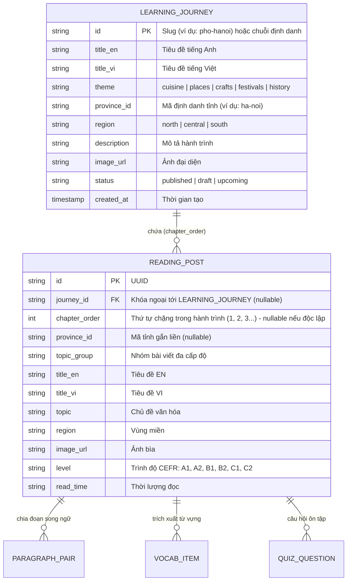

# Kiến trúc Quản lý Hành trình học và Bài đọc song ngữ

Tài liệu đặc tả kiến trúc dữ liệu và API quản lý nội dung giữa Hành trình học (Learning Journey) và Bài đọc thông thường (Standalone Reading Post).

## 1. Phân loại nội dung

Hệ thống chia nội dung thành 2 hình thức:

1. **Hành trình học (Learning Journey / Series):**
   - Đại diện cho chuỗi trải nghiệm học tập gắn liền với một địa phương (`provinceId`, `region`) và chủ đề (`theme`).
   - Một hành trình chứa danh sách các chặng bài đọc có thứ tự (`chapterOrder: 1, 2, 3...`). Khuyến nghị tiêu chuẩn 3 chặng để hiển thị tối ưu trên bản đồ Discovery.
   - Hiển thị trên `/discovery` ở chế độ Bản đồ/Hành trình (`<DiscoveryJourney />`).

2. **Bài đọc thông thường (Standalone Reading Post / Editorial Story):**
   - Các bài đọc đơn lẻ không thuộc chuỗi bài nào (`journey_id = null`).
   - Phân loại theo trình độ CEFR (`level`), chủ đề (`topic`), địa phương (`region`/`provinceId`).
   - Hiển thị trên `/discovery?view=stories` dạng lưới thẻ xã luận (`<EditorialStory />`).

---

## 2. Mô hình Thực thể Quan hệ (Entity-Relationship)

---

## 3. Danh mục API

### 3.1. Hành trình học (`/api/journeys`)
- `GET /api/journeys`: Danh sách hành trình kèm bộ lọc theo `region`, `provinceId`, `theme`, `status`, `query`.
- `GET /api/journeys/{id}`: Chi tiết hành trình kèm danh sách chặng bài đọc theo thứ tự (`chapterOrder`).
- `POST /api/journeys`: Tạo mới hành trình (tự sinh slug hoặc nhận slug tùy chỉnh).
- `PUT /api/journeys/{id}`: Cập nhật thông tin hành trình và danh sách thứ tự chặng bài đọc.
- `DELETE /api/journeys/{id}`: Xóa hành trình (tách bài đọc liên kết thành độc lập hoặc xóa phụ thuộc).

### 3.2. Bài đọc (`/api/posts`)
- Hỗ trợ thêm tham số truy vấn:
  - `standalone=true`: Lọc bài đọc độc lập (chưa gán vào hành trình).
  - `journeyId={id}`: Lọc các bài đọc trực thuộc một hành trình cụ thể.
- Request payload hỗ trợ `journeyId`, `chapterOrder`, `provinceId`.
