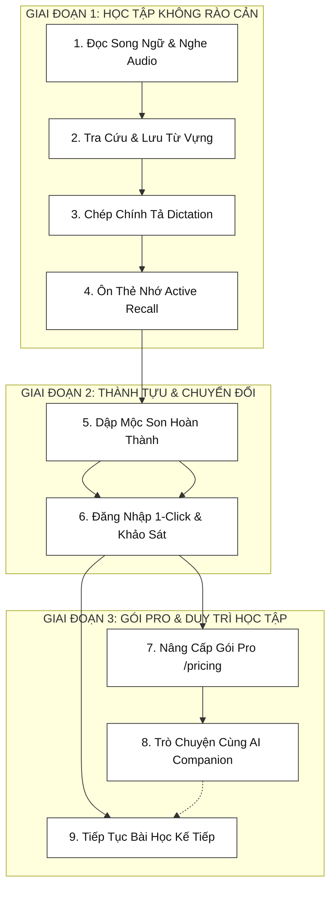

# BÁO CÁO LUỒNG VẬN HÀNH SẢN PHẨM (PRODUCT FLOW)
## Đề Tài: Nền Tảng Học Tiếng Anh Qua Di Sản Văn Hóa – VieCultures

---

### 1. TỔNG QUAN CHU TRÌNH HỌC TẬP KHÉP KÍN

VieCultures vận hành theo chu trình 3 giai đoạn kết hợp giữa **Khoa học Sư phạm (Pedagogy)** và **Mô hình Tăng trưởng Sản phẩm (Product-Led Growth)**:

1. **Giai đoạn 1 (Học tập phi ma sát):** Người học tiếp cận bài học ngay mà không cần tạo tài khoản. Trải nghiệm từ tiếp thu thụ động (*Đọc, Nghe*) đến thực hành chủ động (*Chép chính tả, Ôn thẻ nhớ*).
2. **Giai đoạn 2 (Thành tựu & Chuyển đổi):** Đóng mộc hoàn thành bài học (*Mộc Son Đỏ*), tạo cảm xúc tích cực trước khi yêu cầu Đăng nhập 1-Click để lưu trữ tiến trình.
3. **Giai đoạn 3 (Thương mại hóa & Giá trị cao cấp):** Giới thiệu gói Pro minh bạch qua trang `/pricing` (thanh toán VietQR), mở khóa trợ lý AI đàm đạo văn hóa và tiếp tục chuỗi bài học mới.

---

### 2. SƠ ĐỒ LUỒNG SẢN PHẨM (PRODUCT ARCHITECTURE FLOW)

---

### 3. BẢNG TỔNG HỢP CÁC CHẶNG VẬN HÀNH

| Chặng | Tên Chặng | Thao Tác Người Dùng | Giá Trị Mang Lại Cho Người Học & Sản Phẩm |
| :---: | :--- | :--- | :--- |
| **1** | **Đọc Song Ngữ & Nghe Audio** | Đọc đối chiếu Anh - Việt; nghe giọng đọc bản xứ theo 3 tốc độ (0.5x, 0.8x, 1.0x). | Tiếp thu ngữ liệu tự nhiên, không bị ngợp, tùy chỉnh tốc độ theo trình độ cá nhân. |
| **2** | **Tra Cứu & Lưu Từ Vựng** | Bấm vào từ vựng nổi bật để xem giải nghĩa và ghim từ vào sổ tay cá nhân. | Học từ vựng gắn liền câu văn hóa bản địa (Contextual Learning). |
| **3** | **Chép Chính Tả (Dictation)** | Nghe câu trích từ bài học và gõ từ còn thiếu vào ô trống, nhận kết quả tức thì. | Luyện phản xạ bắt âm và ghi nhớ chính xác mặt chữ. |
| **4** | **Ôn Thẻ Nhớ (Active Recall)** | Lật thẻ 2 mặt và tự đánh giá nhanh: "Chưa Nhớ" hoặc "Đã Thuộc". | Củng cố trí nhớ dài hạn, tinh gọn tối đa thao tác đánh giá. |
| **5** | **Đóng Dấu Mộc Son** | Bấm nút dập dấu đỏ truyền thống khi hoàn thành bài; kích hoạt chuỗi chuyên cần (Streak). | Điểm chạm cảm xúc thành tựu (Aha Moment), tạo bản sắc văn hóa Việt độc bản. |
| **6** | **Đăng Nhập & Khảo Sát** | Đăng nhập nhanh bằng Google/Email để bảo lưu Mộc Son; trả lời 2 câu hỏi mục tiêu học. | Tỷ lệ chuyển đổi tài khoản cao nhờ hiệu ứng sở hữu thành quả vừa đạt được. |
| **7** | **Trang Bảng Giá (/pricing)** | Xem đối chiếu 2 gói (Thường 0đ vs Pro 39.000đ/tháng); quét mã VietQR tự động. | Mô hình kinh doanh minh bạch, thao tác thanh toán quen thuộc, không rào cản. |
| **8** | **AI Cultural Companion** | Nhấp widget chat ở góc phải màn hình để trò chuyện chuyên sâu về văn hóa cùng AI. | Giá trị vượt trội của gói Pro, mang đến trải nghiệm gia sư văn hóa 1-1. |
| **9** | **Tiếp Tục Bài Học Mới** | Nhấp nút "Học Bài Tiếp Theo" để chuyển sang chủ đề di sản tiếp theo trong lộ trình. | Khép kín vòng lặp học tập, duy trì chuỗi học liên tục mỗi ngày. |

---

### 4. BA LUẬN ĐIỂM BẢO VỆ TRƯỚC HỘI ĐỒNG

1. **Trải nghiệm vào bài không ma sát (Frictionless Onboarding):**
   * Người dùng được học thử trọn vẹn bài học đầu tiên (Đọc, Nghe, Chép chính tả, Thẻ nhớ) mà không bị ép buộc đăng ký tài khoản từ đầu. Điều này tối đa hóa tỷ lệ tiếp cận và loại bỏ tâm lý e ngại của người dùng mới.
2. **Chuyển đổi tài khoản sau thành tựu (Achievement-Gated Auth):**
   * Yêu cầu đăng nhập chỉ xuất hiện sau khi người học đã hoàn thành bài học và tự tay dập Mộc Son Đỏ. Dựa trên tâm lý giữ gìn thành quả cá nhân, tỷ lệ người dùng đồng ý tạo tài khoản ở điểm chạm này đạt mức cao nhất.
3. **Mô hình thương mại hóa rõ ràng (Clear Monetization):**
   * Bản miễn phí đáp ứng tốt nhu cầu học cơ bản; bản Pro (39.000đ) tập trung vào giá trị công nghệ cao là Trợ lý AI đàm đạo văn hóa. Luồng thanh toán VietQR trên trang riêng biệt giúp việc nâng cấp diễn ra tự nhiên, thực tế và khả thi về mặt tài chính.
