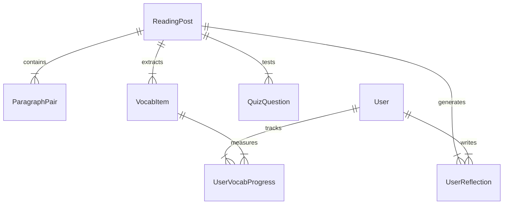

# 🗄️ Từ Điển Dữ Liệu Hệ Thống (System Data Dictionary)

> **Kế thừa từ:** `00_core`  
> **Tham chiếu hằng số:** [`system_constants.md`](./system_constants.md)  
> **Tài liệu liên quan:** [conceptual-diagram.md](../conceptual-diagram.md) | [conceptual-diagram.mmd](../conceptual-diagram.mmd)

Tài liệu quy định cấu trúc dữ liệu, các thực thể (Entities), thuộc tính (Attributes) và mối quan hệ (Relationships) dùng cho Database Schema và API Contracts giữa FE/BE/AI Agents.

---

## 1. Sơ Đồ Thực Thể Quan Hệ (ERD Concept)

---

## 2. Thực Thể `ReadingPost` (Bài Đọc)

| Trường (Field) | Kiểu dữ liệu | Mô tả & Quy tắc |
| :--- | :--- | :--- |
| `id` | `String` (UUID) | Khóa chính của bài đọc. |
| `topic_group` | `String` | **Cụm chủ đề / Nhóm bài**: Tên câu chuyện văn hóa chung để gom các phiên bản đa cấp độ (ví dụ: *"Trà Sen Tây Hồ"*, *"Mì Quảng"*). |
| `title_en` | `String` | Tiêu đề tiếng Anh của bài đọc. |
| `title_vi` | `String` | Tiêu đề tiếng Việt dịch tương ứng. |
| `topic` | `String` | Khớp với `TopicEnum` trong [`system_constants.md`](./system_constants.md). |
| `region` | `String` | Khớp với `RegionEnum` trong [`system_constants.md`](./system_constants.md) (Bắc Bộ / Trung Bộ / Nam Bộ). |
| `level` | `Enum` | Khớp với `ContentBandLevel` (`LEVEL_1`, `LEVEL_2`, `LEVEL_3`) trong [`system_constants.md`](./system_constants.md). |
| `word_count` | `Integer` | Số lượng từ tiếng Anh của bài đọc. |
| `read_time` | `String` | Thời lượng đọc ước tính (ví dụ: *"2 mins"*, *"5 mins"*). |
| `summary` | `Text` | Tóm tắt ngắn gọn nội dung bài đọc (dùng làm cơ sở cho AI Companion Fallback). |
| `counter_perspective` | `Text` | **Phần Phản đề (Chỉ áp dụng cho Level 3)**: Góc nhìn phân tích thực tế, tế nhị, nhân văn. |
| `image_url` | `String` (URL) | Hình ảnh minh họa bài đọc văn hóa. |
| `natural_audio_url` | `String` (URL) | Tệp âm thanh tự nhiên đọc toàn bộ bài đọc (hỗ trợ điều chỉnh tốc độ `1x`, `0.8x`, `0.5x`). |
| `total_reads` | `Integer` | Số lượt người học đã truy cập bài. |
| `likes_count` | `Integer` | Số lượt yêu thích bài đọc. |
| `created_at` | `Timestamp` | Thời gian tạo bài đọc. |

---

## 3. Thực Thể `ParagraphPair` (Cặp Đoạn Song Ngữ)

| Trường (Field) | Kiểu dữ liệu | Mô tả & Quy tắc |
| :--- | :--- | :--- |
| `id` | `String` (UUID) | ID đoạn văn. |
| `post_id` | `String` (FK) | Mã liên kết với `ReadingPost`. |
| `order_index` | `Integer` | Thứ tự đoạn văn trong bài đọc (0, 1, 2...). |
| `en_text` | `Text` | Văn bản đoạn tiếng Anh (Dữ liệu học tập chính). |
| `vi_text` | `Text` | Văn bản đoạn tiếng Việt (Dữ liệu dịch phụ trợ - Tỷ lệ 1:1 nghiêm ngặt). |
| `audio_timestamp_start` | `Float` | Mốc giây bắt đầu trong file audio bài đọc. |
| `audio_timestamp_end` | `Float` | Mốc giây kết thúc trong file audio bài đọc. |

---

## 4. Thực Thể `VocabItem` (Từ Vựng Ngữ Cảnh)

| Trường (Field) | Kiểu dữ liệu | Mô tả & Quy tắc |
| :--- | :--- | :--- |
| `id` | `String` (UUID) | ID từ vựng. |
| `post_id` | `String` (FK) | Mã bài đọc trích xuất từ này. |
| `word` | `String` | Từ gốc hoặc cụm từ (`Word / Phrase`, ví dụ: *cultural heritage*, *lotus tea*). |
| `ipa` | `String` | Phiên âm quốc tế IPA. |
| `pos` | `String` | Từ loại (*noun, verb, adj, phrase...*). |
| `vi_meaning` | `String` | Nghĩa tiếng Việt trong ngữ cảnh. |
| `context_sentence` | `Text` | **Bắt buộc**: Câu tiếng Anh nguyên văn trong bài đọc chứa từ này. |
| `audio_url` | `String` (URL) | File phát âm từ vựng đơn lẻ. |
| `level` | `Enum` | Trình độ CEFR tương ứng của từ (`A2`, `B1`, `B2`). |
| `usage_note` | `Text` | Ghi chú văn hóa hoặc ngữ pháp bổ trợ. |

---

## 5. Thực Thể `UserReflection` (Cảm Nghĩ Người Dùng - UGC)

| Trường (Field) | Kiểu dữ liệu | Mô tả & Quy tắc |
| :--- | :--- | :--- |
| `id` | `String` (UUID) | ID bài viết cảm nghĩ. |
| `user_id` | `String` (FK) | Mã người tạo bài viết. |
| `post_id` | `String` (FK) | Bài đọc liên quan. |
| `content` | `Text` | Nội dung cảm nghĩ tự do (áp dụng chính sách Không phán xét). |
| `used_vocab_ids` | `Array[String]` | Danh sách ID từ vựng đã chèn/nhận diện được trong bài. |
| `reactions_count` | `Integer` | Số lượt thả tim / tương tác (mặc định = 0). |
| `status` | `Enum` | `published` (Đăng ngay) \| `pending_review` (Do bộ lọc từ nhạy cảm kích hoạt). |
| `created_at` | `Timestamp` | Thời gian đăng. |

---

## 6. Thực Thể `UserVocabProgress` (Tiến Độ Flashcard)

| Trường (Field) | Kiểu dữ liệu | Mô tả & Quy tắc |
| :--- | :--- | :--- |
| `user_id` | `String` (FK) | ID người dùng. |
| `vocab_id` | `String` (FK) | ID từ vựng. |
| `status` | `Enum` | `learning` (🔴 Cần ôn lại) \| `mastered` (🟢 Đã nhớ). |
| `review_count` | `Integer` | Số lần đã lật ôn tập. |
| `last_reviewed_at` | `Timestamp` | Thời điểm đánh giá nhị phân gần nhất. |

---

## 7. Thực Thể `QuizQuestion` (Bộ Câu Hỏi Đọc Hiểu)

| Trường (Field) | Kiểu dữ liệu | Mô tả & Quy tắc |
| :--- | :--- | :--- |
| `id` | `String` (UUID) | Khóa chính câu hỏi. |
| `post_id` | `String` (FK) | Mã liên kết với `ReadingPost`. |
| `order_index` | `Integer` | Thứ tự câu hỏi trong bài đọc (0, 1, 2...). |
| `question` | `Text` | Nội dung câu hỏi thấu hiểu văn hóa / nội dung bài đọc. |
| `options` | `JSON Array / Text` | Danh sách 3-4 lựa chọn `[{"key":"A", "text":"..."}, {"key":"B", "text":"..."}]`. |
| `correct_key` | `String` | Khóa đáp án đúng ('A', 'B', 'C', 'D'). |
| `explanation` | `Text` | Lời giải thích ý nghĩa văn hóa hoặc ngữ cảnh bài viết cho đáp án. |

