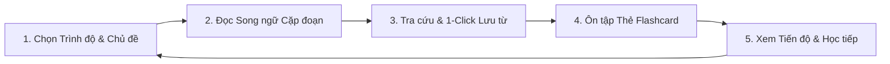

# 📜 Quy Tắc Nghiệp Vụ BR-05: Luồng Trải Nghiệm & Vòng Lặp Học Tập (User Journey)

> **Dự án:** VieCultures  
> **Phiên bản:** Cập nhật đồng bộ theo mô hình MVP 5 bước từ Checkpoint 1 (CP1)

---

## 1. Mục Đích & Phạm Vi
Định hình vòng lặp học tập cốt lõi (Core Learning Loop) của người dùng từ khi bắt đầu chọn bài đọc cho đến khi hoàn thành bài học, lưu từ vựng, ôn tập thẻ nhớ và theo dõi tiến trình cá nhân.

---

## 2. Vòng Lặp Học Tập Cốt Lõi MVP (5-Step Core Learning Flow)

Vòng đời học tập trọng tâm của bản Web MVP được thiết kế tinh gọn qua 5 bước:

### Bước 1: Khám Phá & Chọn Bài Học (Choose Level & Cultural Topic)
- Người dùng chọn trình độ phù hợp (CEFR A2, B1, B2) và chủ đề văn hóa yêu thích (Ẩm thực, Di sản, Lễ hội, Lối sống phong tục).
- Hệ thống hỗ trợ bộ lọc kết hợp giữa Trình độ x Chủ đề để người học chọn bài có độ khó vừa sức.

### Bước 2: Đọc Bài Song Ngữ Cặp Đoạn & Luyện Nghe (Read & Listen)
- Người học đọc bài theo cấu trúc cặp đoạn văn song ngữ đối xứng 1:1 (tiếng Anh chính, tiếng Việt dịch hỗ trợ).
- Bấm vào câu bất kỳ để nghe âm thanh AI đọc chuẩn xác của riêng câu đó phục vụ luyện nhại giọng (Shadowing).

### Bước 3: Tra Cứu Ngữ Cảnh & Lưu Từ Vựng Tức Thì (Click, View & 1-Click Save)
- Người học nhấp trực tiếp vào các từ vựng học thuật được highlight trong văn bản bài đọc.
- Popup giải nghĩa nhanh hiển thị ngay lập tức gồm: Từ gốc, Phiên âm IPA, Từ loại, Nghĩa ngữ cảnh và nguyên văn câu chứa từ trong bài đọc.
- Bấm nút **"Lưu từ" (1-Click Save)** để đưa từ vào sổ tay ôn tập cá nhân mà không bị phân tâm hoặc phải thoát sang app khác.

### Bước 4: Ôn Tập Chủ Động (Active Review via Flashcard / Quiz)
- Chuyển sang màn hình Flashcards để ôn lại các từ vựng vừa lưu hoặc các từ trong bài học.
- Lật thẻ 2 mặt (Mặt trước: Từ + Câu ngữ cảnh gốc; Mặt sau: Phiên âm + Nghĩa + Âm thanh).
- Tự đánh giá nhị phân đơn giản: 🟢 **"Đã nhớ"** (Mastered) hoặc 🔴 **"Cần ôn lại"** (Needs Review).

### Bước 5: Ghi Nhận Tiến Độ & Tiếp Tục Đề Xuất (Track Progress & Next Action)
- Hệ thống ghi nhận tỷ lệ hoàn thành bài học, cập nhật số từ vựng đã nắm vững và tích lũy vào hồ sơ cá nhân.
- Gợi ý bài đọc văn hóa tiếp theo phù hợp với trình độ người học.

---

## 3. Lớp Tính Năng Mở Rộng Cộng Đồng (Optional Community Layer)

- **Cảm nghĩ Cộng đồng (Reflections - UGC):** Sau khi hoàn thành luồng học cốt lõi, người dùng có thể tùy chọn (optional) mở khung viết cảm nghĩ cá nhân ngắn bằng tiếng Anh.
- **Quy tắc quan trọng:** Tính năng Reflection không bắt buộc để tính hoàn thành bài học và là tính năng thử nghiệm ở giai đoạn sau (Post-MVP), tuyệt đối tuân thủ chính sách **"Không chấm điểm / Không phán xét ngữ pháp"** (**BR-03**).

---

## 4. Tiêu Chí Hoàn Thành Bài Học (Lesson Completion Criteria)

- **Quy tắc 5.1**: Một bài đọc được tính là **"Đã hoàn thành" (Completed)** khi người dùng đáp ứng đủ 2 điều kiện bắt buộc:
  1. Đã lật qua tất cả các Flashcard từ vựng của bài học đó ít nhất 1 lần.
  2. Đã bấm tự đánh giá nhị phân cho toàn bộ các từ trong danh sách bài học.
- **Quy tắc 5.2**: Người học có thể mở lại bài học bất kỳ lúc nào để đọc lại hoặc ôn tập lại danh sách từ vựng.
