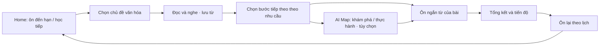

# Kế hoạch sản phẩm: AI Map và gamification trong learning loop VieCultures

Ngày lập: 14/10/2026. Trạng thái: đã chốt định vị trước mắt; quy tắc chi tiết, ngưỡng và kế hoạch triển khai vẫn là đề xuất để thảo luận.

Cập nhật sau thảo luận: lấy sự quan tâm và mục tiêu cá nhân làm điểm bắt đầu; mở rộng AI Map thành công cụ khám phá/thực hành tự chọn; bổ sung mộc son, lời nhận xét của Mascot và thẻ kỷ niệm ở tổng kết phiên học. Các lựa chọn sản phẩm này đã được thống nhất để đưa vào kế hoạch; bảng điểm, ngưỡng và thời lượng vẫn là đề xuất cần kiểm chứng.

Quyết định định vị: chọn hướng **luyện nền tảng và duy trì tiếng Anh** trong giai đoạn trước mắt. Giá trị đầu ra tập trung vào đọc–nghe, nhớ và dùng từ trong ngữ cảnh, từng bước diễn đạt suy nghĩ; nội dung văn hóa Việt Nam là chất liệu học và điểm khác biệt.

Mốc trước mắt do người dùng xác nhận: **hoàn thành prototype trong tuần bắt đầu 19/10/2026**. Sau mốc này mới hoàn thiện, thử nghiệm và triển khai sản phẩm thực tế; chưa chốt ngày phát hành. AI Map hiện hoàn thiện chức năng conversation; phần học theo bài và agent hỗ trợ Reader là hướng phát triển tiếp theo. Kho nội dung đã có, đang duyệt và dự kiến sẵn sàng trong thời gian ngắn.

Phạm vi phân tích: mã nguồn frontend hiện tại, phần backend được cung cấp và tài liệu sản phẩm. Chưa thực hiện phiên học với AI trực tiếp, kiểm thử giao diện chạy thực tế hoặc phân tích dữ liệu người dùng. Những nhận xét về hành vi dưới đây dựa trên triển khai trong mã nguồn; chưa có kết luận về hiệu quả học hay retention thực tế.

## 1. Nhận định và hướng ưu tiên

VieCultures đã có các thành phần để tạo một hành trình học tiếng Anh qua văn hóa: khám phá nội dung, đọc song ngữ, nghe và shadowing, tra từ, flashcards, cộng đồng và AI Map. Công việc trọng tâm là nối các phần này với cùng chủ đề, từ vựng và tiến độ của người học.

Định vị trước mắt đã chốt: **VieCultures là web luyện nền tảng và duy trì tiếng Anh qua những nội dung Việt Nam người học quan tâm.** Cách diễn đạt trải nghiệm: **“Khám phá điều mình quan tâm bằng tiếng Anh, hiểu được và nhớ được.”** AI Map hỗ trợ tìm hiểu văn hóa, hiểu tiếng Anh, nhớ lại kiến thức và diễn đạt suy nghĩ theo nhu cầu của người học. Gamification ghi nhận việc học và giúp người dùng biết nên làm gì tiếp theo. Chỉ số ưu tiên là tiến bộ đọc–nghe và nhớ/dùng từ trên nội dung mới tương đương, cùng số vòng học có ý nghĩa hoàn thành mỗi tuần.

Kế hoạch không mặc định người dùng muốn làm hướng dẫn viên hoặc giới thiệu văn hóa cho bạn bè quốc tế. Nhu cầu học tiếng Anh qua nội dung văn hóa và vai trò thực sự hữu ích của AI cần được kiểm chứng với người dùng. Trải nghiệm cảm xúc bắt đầu từ sự tò mò và cảm giác hiểu thêm một điều; Mascot, mộc son và thẻ kỷ niệm củng cố cảm giác đó.

### Người học và khó khăn cần kiểm chứng

Giả thuyết tệp thử nghiệm: người đã có tiếng Anh cơ bản, trước mắt chọn nội dung A2–B1 để thử nghiệm, muốn luyện thêm hoặc duy trì khả năng sử dụng tiếng Anh. Họ có thể đọc/nghe một phần nhưng còn phụ thuộc vào dịch, tra từ nhiều, học từ rồi quên hoặc khó tự diễn đạt một ý ngắn. Mức độ quan tâm tới nội dung Việt Nam là một yếu tố lựa chọn cần hỏi trực tiếp.

Đây là giả thuyết để tuyển và đánh giá pilot; chưa xác nhận độ tuổi, nghề nghiệp, quy mô thị trường hoặc trình độ thực tế của từng người. Một lượt làm quen/đánh giá nhẹ giúp chọn nội dung vừa sức; không gọi đó là bài xác nhận trình độ CEFR. Sản phẩm cho nhóm bắt đầu từ số không cần chương trình riêng, chưa nằm trong phạm vi bản đầu.

### Giá trị đầu ra cần thiết kế và đo

Lời hứa sản phẩm để kiểm chứng: **“Giúp người đã có tiếng Anh cơ bản luyện đọc–nghe, tích lũy từ trong ngữ cảnh và từng bước diễn đạt ý của mình qua những nội dung Việt Nam họ quan tâm.”** Đây là mục tiêu thiết kế, chưa phải hiệu quả học đã được chứng minh hoặc cam kết đạt trong một thời hạn cố định.

| Đầu ra hướng tới | Cách quan sát tiến bộ |
|---|---|
| Đọc hiểu tốt hơn với ít hỗ trợ hơn | Hiểu ý chính và chi tiết của bài mới ở độ khó tương đương; theo dõi mức dùng bản dịch và tra cứu |
| Nghe hiểu thông tin cần tìm | Trả lời câu hỏi ý chính/chi tiết trên đoạn nghe mới tương đương; ghi nhận số lần nghe lại và hỗ trợ đã dùng |
| Nhớ và dùng từ trong ngữ cảnh | Nhớ lại sau 3–7 ngày, hiểu từ trong câu mới và thử dùng từ trong câu của mình |
| Từng bước diễn đạt suy nghĩ | Viết/nói một nhận xét ngắn có ý rõ, liên quan câu hỏi và dùng từ phù hợp; ghi nhận mức gợi ý AI đã dùng |
| Duy trì việc thực hành có ý nghĩa | Quay lại đọc/nghe/ôn/thực hành trong tuần; tách khỏi đăng nhập, thời gian mở trang và XP |

Vốn từ mục tiêu gồm những từ/cụm từ có ích cho đọc–nghe và diễn đạt, bên cạnh từ đặc thù văn hóa. Mỗi bài cần nêu rõ người học thực hành kỹ năng nào, thay vì chỉ ghi địa điểm hoặc danh mục văn hóa.

Hoàn thành một bài, nhớ chính đáp án vừa gặp hoặc tăng XP là bằng chứng hoạt động. Đánh giá tiến bộ cần nội dung mới tương đương, mức hỗ trợ rõ ràng và so sánh với điểm xuất phát. Tách thành tích học tập, mức ghi nhớ và tiến bộ năng lực trong hồ sơ.

### Phạm vi lời hứa trước mắt

Định vị luyện nền tảng và duy trì tiếng Anh chưa bao gồm lộ trình luyện thi IELTS/TOEIC hoặc đào tạo tiếng Anh cho một nghề cụ thể. Web hiện chưa có bằng chứng để cam kết IELTS 6.0, TOEIC 800, đạt một bậc CEFR hoặc tìm được việc. Nếu người dùng có các mục tiêu đó, cần thể hiện rõ phạm vi hỗ trợ của VieCultures; việc thêm chương trình tương ứng là một quyết định sản phẩm riêng trong tương lai.

## 2. Hiện trạng sản phẩm

| Thành phần | Những gì đã có | Khoảng trống ảnh hưởng đến kế hoạch |
|---|---|---|
| Home / phòng học | Mục tiêu học, điều hướng, Pomodoro, giao diện phòng học | Checklist ban đầu dùng dữ liệu mẫu và người dùng tự đánh dấu; chưa phản ánh thống nhất kết quả từ các màn hình học |
| Discovery | Tìm bài theo văn hóa, vùng miền và độ khó; tương tác bản đồ | Cần gợi ý bước tiếp theo và giữ đúng chủ đề khi chuyển màn hình |
| Reader | Đọc song ngữ/chuyên sâu, nghe, tra từ, quiz; hỗ trợ lấy bài từ backend | Từ được đánh dấu trong trang chưa thấy nối thành kho từ cá nhân dùng xuyên suốt; nút sang flashcards chưa mang theo bài hiện tại |
| Flashcards | Lật thẻ, trắc nghiệm, spelling, chọn bộ thẻ | Các nút “Đã nhớ/Cần ôn lại” trong trang hiện chủ yếu chuyển thẻ; chưa thấy ghi nhận kết quả và lịch ôn bền vững |
| AI Map | Theo xác nhận của người dùng: conversation đã hoàn thiện; có phần bản đồ và các thành phần chuẩn bị luồng bài học trong mã | Học theo bài chưa hoàn thiện; conversation chưa tương đương một phiên học có mục tiêu; agent hỗ trợ Reader là phạm vi tương lai |
| Gamification | Có bộ quản lý XP, xu, cấp bậc, streak, nhiệm vụ, huy hiệu và các thành phần giao diện | Nhiều giá trị khởi tạo/nhiệm vụ là dữ liệu mẫu; chưa thấy hoạt động học gọi cơ chế thưởng; các thành phần UI chưa chứng minh đã vận hành xuyên suốt |
| Community | Chia sẻ, thử thách và các thẻ nhiệm vụ/cửa hàng | Dùng làm mở rộng sau vòng học; tránh để tương tác xã hội chi phối phần thưởng học tập |

Mã nguồn có phần chuẩn bị chuỗi Khám phá → Lắng nghe → Luyện nói → Kiểm tra; theo xác nhận của người dùng, luồng học này chưa hoàn thiện và không được coi là chức năng đã sẵn sàng. Một số bước hiện tiến khi yêu cầu gửi tới AI thành công; điều này chưa đủ chứng minh người học đã thực hiện nhiệm vụ. Quiz tạo sẵn chủ yếu hỏi tỉnh, nhóm nội dung và cấp độ; khi phát triển phần học theo bài, cần chuyển sang kiểm tra hiểu bài. Kết quả do AI báo lại cần được đối chiếu với câu hỏi và câu trả lời của phiên học.

Một điểm cần tách rõ: “Level 1–3” đang được dùng cho cả độ khó nội dung và cấp bậc tích lũy XP. Cấp bậc hoạt động không đại diện cho trình độ tiếng Anh. Nội dung địa lý và tên địa điểm trong các nguồn cũng cần được thống nhất trước khi mở rộng hộ chiếu bản đồ.

## 3. Learning loop đề xuất

Phần này mô tả trải nghiệm đích sau prototype. Prototype tuần 19/10 ưu tiên một vòng Reader → ôn từ → tổng kết hoạt động được, cùng conversation hiện có ở một điểm vào tùy chọn. Phiên AI theo bài và các điều kiện hoàn thành/thưởng tương ứng chỉ được kích hoạt sau khi chức năng đó được xây và kiểm chứng. Mascot có thể minh họa câu hỏi theo bài từ bộ câu hỏi đã biên tập; phải phân biệt với agent theo bài đang chạy thật.

Phiên cơ bản dự kiến 5–8 phút. Phiên có AI Map dự kiến 10–15 phút. Đây là ngân sách trải nghiệm để thử nghiệm, chưa phải thời lượng đã đo.

Home có một điểm bắt đầu rõ ràng: “Bắt đầu hành trình hôm nay” cho người chưa có phiên học và “Tiếp tục học” cho người đang học dở. Hành trình ngắn (Daily Cultural Quest) giữ cùng chủ đề qua các bước, gợi ý dựa trên sở thích và tiến độ, cho phép bỏ qua AI. Mốc 6 phút chỉ là phương án thử nghiệm với mẩu đọc nhỏ và ít nhiệm vụ, không áp dụng cho mọi phiên.

### Vai trò của AI Map

1. **Trước bài học:** người dùng chọn địa điểm trên bản đồ, nhận gợi ý bài phù hợp. Luồng khám phá tự do vẫn được giữ.
2. **Sau đọc hoặc ôn ngắn:** AI nhận đúng chủ đề, độ khó và từ đã học, rồi hỗ trợ mục tiêu người học chọn. Đây là vị trí tích hợp ưu tiên; có thể ôn ngắn trước khi thực hành nếu cần chuẩn bị từ.
3. **Sau phiên học:** tổng kết nội dung đã tìm hiểu, từ đã ôn/dùng, điểm cần ôn và hành động tiếp theo. Từ mới chỉ vào sổ tay khi người dùng chọn lưu; không tự lưu toàn bộ hội thoại.

| Mục tiêu người học | Trải nghiệm AI Map đề xuất | Bằng chứng hoàn thành phiên hướng dẫn |
|---|---|---|
| Tìm hiểu thêm một nét văn hóa | Giải thích, ví dụ và trả lời câu hỏi bám nội dung đã biên tập | Hoàn thành 2 hoạt động ngắn và một lượt nhớ lại ý chính |
| Hiểu tiếng Anh trong bài | Làm rõ ý, từ và cách diễn đạt; đưa ví dụ đúng độ khó | Hoàn thành 2 hoạt động diễn giải/chọn ý và kiểm tra ngắn |
| Ôn lại điều vừa học | Gợi nhớ, hỏi ngắn, giải thích phần còn nhầm | Hoàn thành bộ câu hỏi nhớ lại đã chọn, xem phần cần củng cố |
| Diễn đạt suy nghĩ cá nhân | Hỗ trợ một nhận xét, so sánh hoặc trải nghiệm bằng chữ/giọng nói | Hoàn thành 2 nhiệm vụ diễn đạt, thử dùng 2 từ/cụm từ mục tiêu và tự xem lại với gợi ý |
| Luyện giao tiếp | Tình huống nhập vai do người học chọn | Hoàn thành 2 nhiệm vụ giao tiếp có tiêu chí nội dung và thử dùng 2 từ/cụm từ mục tiêu |

Đây là các lựa chọn trải nghiệm dự kiến khi phát triển hỗ trợ theo bài, không phải năm tính năng lớn phải xây đồng thời. Giai đoạn sau prototype ưu tiên “Tìm hiểu thêm”, “Ôn lại” và “Thử diễn đạt suy nghĩ”; nhập vai là một lựa chọn trong phần thực hành. Conversation hiện có vẫn được giữ, không bắt mọi câu hỏi phải kết thúc bằng quiz. Chỉ phiên hướng dẫn đã triển khai, có mục tiêu và bằng chứng hoàn thành mới được tính khoản thưởng phiên AI.

Khi hỗ trợ theo bài được triển khai, phiên AI sau đọc không cần lặp lại toàn bộ chuỗi đọc/nghe đã thực hiện. Mỗi phiên hướng dẫn dự kiến có 2–3 hoạt động phù hợp với mục tiêu đã chọn; câu hỏi kiểm tra hiểu nội dung hoặc lượt tự xem lại được lồng vào phiên, tránh kiểm tra trùng lặp. Guided Lesson đầy đủ từ bản đồ là phương án mở rộng sau khi phần theo bài được hoàn thiện.

### Mascot và agent hỗ trợ bài đọc trong tương lai

Mascot là điểm tương tác với người học; agent là phần xử lý hỗ trợ bên dưới. Hỗ trợ theo bài có thể dùng các khả năng conversation hiện có, nhưng cần thêm ngữ cảnh bài, mục tiêu và điều kiện hoàn thành; không phụ thuộc việc phải mở giao diện bản đồ.

Sau khi đọc, Mascot có thể mời “Cùng ôn lại bài vừa đọc?” hoặc “Có chỗ nào bạn muốn hiểu thêm?”. Người học chọn bắt đầu thì agent nhận nội dung đã duyệt, độ khó, từ mục tiêu và phần cần củng cố; hỏi từng câu, chờ phản hồi, đưa gợi ý rồi tổng kết. “Đọc xong” và “hoàn thành toàn bộ phiên học” là hai mốc khác nhau: lượt câu hỏi có thể nằm giữa đọc và tổng kết cuối phiên.

Prototype có thể dùng 2–3 câu hỏi soạn sẵn để minh họa tương tác qua Mascot. Giai đoạn thực tế mới bổ sung câu hỏi linh hoạt bám nguồn và phản hồi theo câu trả lời. Luôn cho phép bỏ qua; không tự bật micro hoặc tự tính đã hoàn thành nhiệm vụ vì AI đã hỏi.

Ví dụ chủ đề Áo dài: đọc và lưu 3–5 từ → chọn “Tìm hiểu thêm” để làm rõ một nét văn hóa, “Ôn lại” để nhớ ý chính, hoặc “Thử diễn đạt suy nghĩ” để viết/nói một nhận xét cá nhân → ôn từ còn yếu → xem tổng kết và nhận dấu chủ đề → quay lại ôn theo lịch. Người muốn luyện giao tiếp có thể chọn AI đóng vai du khách hỏi về áo dài.

Trong kịch bản nhập vai, người nghe là AI mô phỏng nhân vật; web được phân tích chưa có cơ chế kết nối người học với người thật. AI và người thật khác nhau về mục đích trò chuyện, cách phản ứng, sự khó đoán và cảm giác khi giao tiếp. Thành tích ghi nhận thực hành với AI; khả năng vận dụng với người thật chưa được kiểm chứng. Lời giới thiệu tính năng và tổng kết phải thể hiện đúng phạm vi này.

### Ghi nhận theo hoạt động và mục tiêu

| Trạng thái | Điều kiện đề xuất |
|---|---|
| Hoàn thành bài cơ bản | Hoàn thành bài đọc và kiểm tra hiểu nội dung ngắn; đã ôn và tự đánh giá tất cả thẻ trong bộ từ mục tiêu của phiên |
| Hoàn thành phiên AI Map có hướng dẫn | Đáp ứng tiêu chí của mục tiêu đã chọn trong bảng trên; có hoạt động thực tế của người học, không chỉ có lời đáp của AI |
| Loại hoạt động AI Map | Lưu rõ khám phá, ôn lại, diễn đạt hoặc nhập vai; khi có nhập liệu giọng nói, phân biệt với phiên chỉ dùng chữ |
| Cần củng cố | Câu hỏi sai hoặc từ chưa nhớ được đưa vào lượt ôn tiếp theo; vẫn ghi nhận nỗ lực và các bước đã làm |

“Hoàn thành” và “nắm vững” là hai trạng thái khác nhau. Đạt quiz không đủ chứng minh ghi nhớ lâu dài. Ngưỡng thử nghiệm cho quiz là 2/3 câu đúng; cho phép xem giải thích và thử lại, không thưởng lặp.

AI Map là phần khám phá/thực hành tùy chọn, chưa bắt buộc để hoàn thành bài cơ bản trong bản đầu. Các lựa chọn hướng dẫn có mức thưởng phiên tương đương khi đáp ứng tiêu chí; người học không phải chọn nhập vai để đạt dấu hoàn thành chủ đề cơ bản. Phản hồi bằng chữ được hỗ trợ khi không có micro; phân biệt hoàn thành nhiệm vụ bằng chữ và thực hành nói thực tế. Không tuyên bố cải thiện phát âm chỉ từ nội dung bản chép lời.

Các điều kiện trên thay đổi BR-05 hiện tại, vốn ghi nhận hoàn thành dựa trên lật và tự đánh giá toàn bộ flashcards. Cần chốt lại BR-05 trước triển khai. Không thay đổi chính sách Reflection tùy chọn và không chấm ngữ pháp của BR-03.

## 4. Gamification đề xuất

### Phạm vi ưu tiên

| Cơ chế | Vai trò | Bản đầu |
|---|---|---|
| XP và cấp bậc hành trình | Ghi nhận hoạt động học; tạo cảm giác tiến lên | Có; dùng danh hiệu di sản, hiển thị tách với trình độ tiếng Anh |
| Streak | Khuyến khích quay lại và học có ý nghĩa | Có; tính bằng hoạt động hoàn thành, không bằng đăng nhập |
| Nhiệm vụ hằng ngày | Chỉ dẫn phiên học tiếp theo | Có; tối đa 2–3 nhiệm vụ vừa sức |
| Hộ chiếu di sản | Lưu dấu chủ đề đã hoàn thành và loại hoạt động đã thực hiện | Có; bắt đầu với một số chủ đề mẫu |
| Huy hiệu | Ghi nhận cột mốc rõ ràng | Có; một bộ nhỏ có điều kiện kiểm chứng |
| Mộc son và Mascot ở tổng kết | Ghi nhận thành quả bằng hình ảnh di sản và nhận xét cụ thể | Có; hiệu ứng ngắn, có lựa chọn giảm chuyển động |
| Lưu thẻ kỷ niệm | Lưu một thành quả cá nhân thành ảnh | Tùy chọn sau khi tổng kết và tiến độ thật đã ổn định |
| Xu và cửa hàng | Cá nhân hóa trải nghiệm | Giai đoạn sau khi việc ghi nhận thưởng ổn định |
| Bảng xếp hạng, duel, mùa giải | Hoạt động cộng đồng/cạnh tranh | Giai đoạn sau khi có dữ liệu sử dụng |

Hộ chiếu nhận dấu **theo chủ đề**. Hoàn thành một bài về Huế chỉ nhận dấu cho chủ đề đó. Bộ sưu tập địa phương cần một danh sách chủ đề đủ rõ, tránh tạo cảm giác đã hiểu toàn bộ một địa phương chỉ sau một bài.

Dấu thành tích đã đạt được bảo lưu khi thêm bài mới hoặc đến hạn ôn. Nội dung mới và lời nhắc ôn được hiển thị riêng. Lịch ôn dựa trên kết quả học; mốc “45 ngày ký ức phai” chưa được chọn làm quy tắc sản phẩm.

### Bảng XP thử nghiệm

Bảng dưới là quy tắc đích. Prototype trước mắt dùng một bộ điểm chung cho đọc/kiểm tra và ôn từ; khoản thưởng phiên AI, bonus có AI và huy hiệu phiên AI tạm chưa kích hoạt. Conversation tự do không tự được tính hoàn thành bài hoặc nhận thưởng phiên học theo bài.

| Hoạt động | XP đề xuất | Quy tắc |
|---|---:|---|
| Hoàn thành đọc + kiểm tra hiểu bài | 20 | Một lần cho mỗi bài ở độ khó đã chọn; thử lại không nhận lại |
| Hoàn thành lượt ôn từ mới của bài | 15 | Đánh giá đủ bộ thẻ mục tiêu; không nhân điểm theo số lần bấm |
| Hoàn thành phiên AI Map có hướng dẫn | 20 | Đạt tiêu chí theo mục tiêu đã chọn; không thưởng chỉ vì mở chat hoặc gửi một tin nhắn |
| Bonus hoàn thành chuỗi cơ bản + phiên AI hướng dẫn | 10 | Một lần khi đủ ba phần trên; áp dụng cho các lựa chọn AI hợp lệ, là khoản bonus công bố riêng |
| Ôn đến hạn | 10 | Một lượt hợp lệ/ngày, tối thiểu 5 thẻ khác nhau hoặc toàn bộ thẻ đến hạn nếu ít hơn 5 |

Tổng một chủ đề mới: 35 XP cho bài cơ bản, 65 XP nếu có phiên AI hướng dẫn và bonus. Đổi mục tiêu AI của cùng chủ đề không tạo khoản thưởng hoàn thành mới. Phiên AI dùng để ôn đến hạn nhận thưởng ôn, không nhận đồng thời thưởng phiên AI mới. XP đọc đã bao gồm quiz, không cộng thêm thưởng quiz. Nhiệm vụ ngày đầu tiên chỉ ghi nhận tiến độ, không tạo một lớp thưởng trùng. Các mức trên là giả thuyết cân bằng sản phẩm; thay thế bảng điểm hiện tại sau khi được chốt, không cộng song song với quy tắc cũ.

Mỗi người học được thưởng tối đa 3 chủ đề mới/ngày trong thử nghiệm; vẫn được học thêm. Chuyển độ khó không tự tạo lại thưởng cho cùng chủ đề trong ngày. Không thưởng theo số tin nhắn AI, thời gian mở trang, số lần tra từ hoặc lượt thả tim. Quay lại một chủ đề để ôn nhận thưởng theo lượt ôn hợp lệ, không lặp thưởng hoàn thành mới.

### Streak và nhiệm vụ

- Ngày hợp lệ khi hoàn thành một bài đọc kèm kiểm tra, một lượt ôn đến hạn, một phiên AI Map có hướng dẫn theo tiêu chí đã chọn khi chức năng đó đã sẵn sàng, hoặc 3 câu dictation theo quy tắc được chốt.
- Mỗi ngày chỉ tăng streak một lần, theo múi giờ tài khoản; mặc định Asia/Ho_Chi_Minh cho nhóm thử nghiệm Việt Nam. Không tăng ngày chỉ từ một tin nhắn AI.
- Mục tiêu ngày gợi ý: “Ôn từ đến hạn”, “Tiếp tục bài đang học”, “Khám phá điều bạn quan tâm”. Dựa trên sở thích và tiến độ thật; checklist cá nhân vẫn có thể giữ nhưng không cấp thưởng học tập.
- Khi bỏ lỡ ngày học, hiển thị lời mời quay lại nhẹ nhàng. Cơ chế bảo vệ streak có thể bổ sung sau khi quy tắc ngày học ổn định.

Huy hiệu dự kiến: bài cơ bản đầu tiên; phiên AI hướng dẫn đầu tiên khi tính năng đã sẵn sàng; 3 chủ đề khác nhau đã hoàn thành; 3 ngày học liên tiếp; quay lại hoàn thành lượt ôn đến hạn đầu tiên. Prototype chỉ kích hoạt các huy hiệu gắn với hành vi đã triển khai. Huy hiệu thành tích được kiếm bằng hoạt động học; vật phẩm mua bằng xu chỉ mang tính trang trí.

## 5. Thay đổi trải nghiệm theo màn hình

Bảng dưới mô tả trải nghiệm đích. Phạm vi prototype và phần sau prototype được tách ở mục 6; riêng các lựa chọn AI theo bài chưa phải chức năng hiện có.

| Màn hình | Thay đổi ưu tiên |
|---|---|
| Home | Một nút chính theo trạng thái: “Bắt đầu hành trình hôm nay” hoặc “Tiếp tục học”; chủ đề theo sở thích, ôn đến hạn, nhiệm vụ thật và hộ chiếu nhỏ. Khi có từ đến hạn, ưu tiên lượt ôn ngắn |
| Discovery / bản đồ | Hiển thị chủ đề đang học/đã học; chọn “Đọc bài” hoặc “Khám phá cùng AI”; phân biệt rõ nơi có nội dung và nơi chưa có |
| Reader | Giữ đúng bài và độ khó khi chuyển sang flashcards; lưu từ vào sổ tay chung; cuối bài chỉ dẫn bước ôn ngắn |
| Flashcards | Ghi nhận “Đã nhớ/Cần ôn lại”; có tổng kết phiên; nếu chưa dùng AI, gợi ý khám phá/thực hành đúng chủ đề |
| AI Map | Điểm vào trực tiếp từ bài; chọn “Tìm hiểu thêm”, “Ôn lại” hoặc “Thử diễn đạt suy nghĩ”; nhập vai tự chọn; mục tiêu ngắn, chữ/giọng nói, lưu từ chọn lọc, tạm dừng và tiếp tục |
| Tổng kết | Hiển thị việc đã làm, từ cần ôn, XP và dấu hộ chiếu; mộc son và lời nhận xét cụ thể của Mascot; một hành động chính để tiếp tục, nút “Lưu thẻ kỷ niệm” tùy chọn |
| Hồ sơ / tiến độ | Xem chủ đề đã học, loại hoạt động AI, từ cần ôn và danh hiệu. Tách hoạt động/XP, mức ghi nhớ và kết quả đánh giá đọc–nghe/diễn đạt với mức hỗ trợ đã dùng |

### Ba điểm chạm cảm xúc

**Tổng kết phiên học:** gom thông báo thưởng; khi lần đầu đạt điều kiện của một dấu thành tích, hiển thị mộc son đóng xuống trang hộ chiếu bằng hiệu ứng ngắn. Xem lại tổng kết chỉ hiển thị dấu đã có, không tạo lại thành tích hoặc phần thưởng. Mascot nhận xét dựa trên việc đã làm, ví dụ “Bạn đã ôn 4 từ và phân biệt được hai ý chính.” Nhãn dấu như “Đã hoàn thành chủ đề Áo dài” phải đúng phạm vi, không suy diễn thành thông thạo một địa phương.

**AI Map theo nhu cầu:** sự gần gũi đến từ việc giải thích đúng chỗ người học đang vướng, gợi ý vừa sức và giúp họ hiểu/diễn đạt được điều trước đó còn khó. Người muốn nhập vai có thể chọn nhân vật, bối cảnh và mục tiêu; người khác tiếp tục khám phá hoặc ôn. Lời chào và gợi ý không mặc định nhu cầu giới thiệu văn hóa cho du khách.

**Thẻ kỷ niệm:** nút “Lưu thẻ kỷ niệm” là hành động phụ tại tổng kết. Ảnh gồm chủ đề, hình ảnh di sản có nguồn sử dụng phù hợp, dấu thành tích thật và câu diễn đạt gắn với nội dung đã học. Tên cá nhân cho phép bật/tắt; người dùng xem trước rồi lưu ảnh. Thẻ dùng được cho lưu trữ cá nhân, hình nền hoặc chia sẻ tự nguyện; bản đầu không tự đăng lên mạng xã hội và không thưởng cho việc chia sẻ. Phạm vi là một mẫu ảnh tĩnh; vẫn cần thiết kế, kiểm tra ảnh xuất và đánh giá công sức trước khi cam kết thời gian.

Tác dụng cảm xúc, mong muốn lưu/chia sẻ và tác động đến việc quay lại là các giả thuyết của pilot. Chưa có căn cứ để khẳng định hiệu ứng mộc son tạo “đỉnh dopamine” hoặc thẻ kỷ niệm tự tạo tăng trưởng.

Giữ phong cách di sản hiện tại. Dùng cùng cách hiển thị tiến độ và nút học tiếp trên các màn hình. Mobile phải có danh sách chủ đề thay cho thao tác bản đồ nhỏ; trạng thái có nhãn ngoài màu sắc; có thể giảm chuyển động và dùng bàn phím.

Nếu AI hoặc micro không hoạt động, giữ tiến độ đã làm và cho phép tiếp tục phần cơ bản hoặc phản hồi bằng chữ khi dịch vụ hỗ trợ. Không cấp thành tích luyện nói cho một phiên chỉ dùng chữ. Không gửi được câu trả lời thì chưa ghi nhận nhiệm vụ đó hoàn thành.

## 6. Lộ trình triển khai và kết quả bàn giao

### Giai đoạn A: hoàn thành prototype trong tuần bắt đầu 19/10/2026

Mốc xác nhận là tuần bắt đầu thứ Hai 19/10/2026, không mặc định ngày 19/10 là hạn bàn giao. Ngày demo cụ thể trong tuần chưa được chốt. Prototype chứng minh trải nghiệm và một vòng học hoạt động; chưa phải sản phẩm công khai đã hoàn thiện.

| Mức ưu tiên | Kết quả bàn giao prototype |
|---|---|
| Bắt buộc | Một kịch bản liền mạch: Home → chọn bài → Reader → lưu/ôn từ đúng bài → tổng kết; có trạng thái học dở và bước tiếp theo |
| Bắt buộc | Conversation AI Map hiện có truy cập được như hoạt động tùy chọn; luồng cơ bản tiếp tục được khi AI không kết nối |
| Bắt buộc | Một bộ quy tắc XP, nhiệm vụ, streak và dấu chủ đề nhất quán cho hành vi đã triển khai; tổng kết có mộc son/Mascot; thử lại không thưởng trùng |
| Bắt buộc | Ít nhất một bài được duyệt đủ để demo vòng học; đưa 3–5 chủ đề vào khi kho dữ liệu duyệt kịp; phân biệt dữ liệu minh họa và thành tích người học |
| Theo khả năng thời gian | Mascot hỏi 2–3 câu đã biên tập để minh họa phần theo bài; một mẫu thẻ kỷ niệm tĩnh |
| Sau prototype | Agent đọc ngữ cảnh và hỏi đáp linh hoạt theo bài; tài khoản/lưu tiến độ thực tế; lịch ôn hoàn thiện; đo lường học và vận hành trên người dùng thật |

Đề xuất phạm vi lưu prototype: trên một trình duyệt/một thiết bị để minh họa tiếp tục học; ghi rõ giới hạn. Không dùng phạm vi đó làm cam kết lưu tiến độ theo tài khoản hoặc đồng bộ nhiều thiết bị. Các trạng thái minh họa có thể dùng để demo, nhưng không được nhập thành điểm xuất phát hoặc kết quả thật của người mới.

### Giai đoạn B: hoàn thiện sau prototype

Thời gian triển khai cụ thể được đánh giá lại từ kết quả prototype, không giữ khung 6–8 tuần cũ như một cam kết.

1. Sửa các chỗ vướng trong vòng học, hoàn thiện kho từ và lịch ôn; chuẩn hóa dữ liệu đã duyệt.
2. Phát triển hỗ trợ theo bài: Mascot là giao diện, agent nhận đúng ngữ cảnh để hỏi/gợi ý/tổng kết; kích hoạt tiêu chí và thưởng phiên AI khi đã kiểm chứng.
3. Hoàn thiện tài khoản, tiến độ theo người học, chống thưởng trùng và cách đo hoạt động; chốt ngân sách AI và giới hạn phiên.
4. Pilot học thật dự kiến 20–30 người trong 2 tuần, có đánh giá đầu vào/đầu ra và lượt ôn sau 3–7 ngày. Quy mô là đề xuất, có thể điều chỉnh theo người tham gia.
5. Dựa trên lỗi, nhu cầu và tín hiệu kết quả học để quyết định phát hành thực tế; tiếp tục theo dõi sau phát hành.

Phân công ở góc độ sản phẩm: bạn chọn nội dung demo, xác nhận ưu tiên và mời người thử; người phụ trách nội dung duyệt bài/từ/câu hỏi; nhóm phát triển nối hành trình và tiến độ; người kiểm thử kiểm chứng phiên học và các tình huống gián đoạn. Các vai trò có thể do cùng một người đảm nhận.

Kho nội dung đã có và đang duyệt theo xác nhận của bạn. Mỗi bài dùng cho vòng học cần có mục tiêu kỹ năng, bài đọc/âm thanh phù hợp, bộ 3–5 từ mục tiêu, câu hỏi hiểu bài và đáp án/giải thích. Trước demo cần chọn ít nhất một bộ đã được duyệt; không đặt việc biên soạn lại toàn bộ kho thành điều kiện hoàn thành prototype. Bộ đánh giá đầu vào/đầu ra với nội dung mới tương đương chuẩn bị ở giai đoạn học thật; có thể làm thủ công trước khi xây thành tính năng web.

## 7. Đo lường và tiêu chí nghiệm thu

### 7.1. Ba câu hỏi đo lường, ở ba giai đoạn khác nhau

| Giai đoạn | Cần trả lời | Bằng chứng phù hợp |
|---|---|---|
| Prototype tuần 19/10 | Người học có hiểu web và đi hết một vòng học được không? | Chạy kịch bản, quan sát thao tác, chỗ mắc và lỗi; chưa kết luận học tốt hơn |
| Thử trải nghiệm sau prototype | Nội dung và cách học có phù hợp nhu cầu, đủ rõ để tự dùng không? | Buổi thử với khoảng 5–8 người phù hợp; phỏng vấn ngắn; ghi hành vi và lý do bỏ dở |
| Pilot học thật / sản phẩm thực tế | Người học có tiến bộ và quay lại thực hành không? | Đánh giá đầu vào/đầu ra, nhớ lại sau 3–7 ngày, dữ liệu hoạt động và chi phí |

“Baseline” là điểm xuất phát trước đợt học. “Nghiệm thu” là kiểm tra chức năng/trải nghiệm đã bàn giao đúng. “Kết quả học” là thay đổi trong khả năng hiểu, nhớ và diễn đạt. Ba khái niệm này được ghi riêng trong báo cáo.

### 7.2. Nghiệm thu prototype tuần 19/10

Thử với ít nhất một người chưa được hướng dẫn từng nút. Có thể quan sát và ghi bằng bảng đơn giản; chưa cần dashboard phân tích hoặc hệ thống chấm năng lực tự động.

| Tình huống thử | Kết quả cần đạt | Nếu chưa đạt thì ưu tiên sửa gì? |
|---|---|---|
| Vào Home, tìm việc nên làm | Hiểu định vị và chọn được bắt đầu/học tiếp | Lời giới thiệu, nút chính, quá nhiều lựa chọn |
| Chọn một bài, đọc và lưu từ | Đúng bài; nghĩa và câu ngữ cảnh rõ; từ lưu xuất hiện ở bộ ôn tương ứng | Nối bài–từ–bộ thẻ, thông báo lưu |
| Ôn bộ từ và tự đánh giá | Thao tác rõ; ghi nhận từ cần ôn/đã nhớ; kết thúc được lượt ôn | Trạng thái học và nút kết thúc |
| Xem tổng kết | Biết đã làm gì, nhận gì và học tiếp thế nào; dấu/XP đúng hành vi | Nội dung tổng kết và quy tắc thưởng |
| Tải lại, học dở, mở lại tổng kết | Giữ tiến độ theo phạm vi prototype; không cộng trùng | Lưu tiến độ và nhận thưởng |
| Thử conversation rồi quay lại học | Không mất bài đang học; conversation không tự cấp thành tích theo bài | Điều hướng và phân biệt hai hoạt động |
| AI lỗi/không có micro | Có thông báo rõ và đường tiếp tục bài cơ bản | Trải nghiệm gián đoạn |
| Xem trên mobile | Đọc, lưu, ôn và tiếp tục được; không phụ thuộc thao tác bản đồ nhỏ | Bố cục, nút và danh sách chủ đề |

Prototype đạt khi vòng học bắt buộc chạy được, các lỗi chặn luồng đã được xử lý và phần minh họa được phân biệt rõ với chức năng thật. Chưa yêu cầu agent theo bài, đồng bộ nhiều thiết bị, đo retention hoặc chứng minh tăng trình độ.

### 7.3. Kiểm chứng nhu cầu và trải nghiệm sau prototype

Mời khoảng 5–8 người có tiếng Anh cơ bản, muốn luyện hoặc duy trì và có thể quan tâm một chủ đề trong kho. Chọn người có khó khăn khác nhau về đọc, nghe hoặc từ vựng; không chỉ hỏi người quen đã hiểu dự án.

Trước khi dùng, hỏi về lần học gần nhất: mục tiêu, nội dung họ dùng, chỗ vướng và cách xử lý. Cho chọn một bài rồi tự học. Sau phiên, hỏi “Bạn học được gì?”, “Chỗ nào khó/không rõ?”, “Bạn muốn quay lại để làm gì?” và “AI đã giúp chỗ nào?”. Hỏi ý định quay lại để tìm lý do; việc quay lại thực tế phải đo sau.

Ghi kết quả thành: người tham gia và khó khăn → hành vi quan sát → chỗ vướng → đề xuất sửa. Một lời khen hoặc thích Mascot là phản hồi trải nghiệm; chưa phải bằng chứng tiến bộ tiếng Anh. Hoạt động này có thể bắt đầu với một vài người trước demo nếu thuận tiện, không là điều kiện phải hoàn thành nghiên cứu lớn trước prototype.

### 7.4. Đo kết quả học: người học tiến bộ ở đâu?

Chuẩn bị bộ A để đo điểm xuất phát và bộ B chưa học nhưng tương đương về độ khó, độ dài và kiểu nhiệm vụ để đo sau đợt học. Người phụ trách nội dung duyệt sự tương đương. Ghi điều kiện làm bài: có/không bản dịch, tra từ, số lần nghe lại và mức gợi ý. Nếu cho dùng hỗ trợ, so sánh dưới cùng điều kiện; không coi câu trả lời AI viết hộ là năng lực tự làm.

| Đầu ra | Bài đo nhỏ gợi ý | Cách đọc kết quả |
|---|---|---|
| Đọc hiểu | Một đoạn mới, 1 câu ý chính và 2 câu chi tiết | Đúng hơn dưới điều kiện tương đương, hoặc giữ độ đúng với ít hỗ trợ hơn là tín hiệu tiến bộ; nhanh hơn nhưng sai nhiều chưa đủ |
| Nghe hiểu | Một đoạn nghe mới, 1 câu ý chính và 2 câu chi tiết | So số đúng cùng tốc độ/số lượt nghe; tách kết quả có nghe lại hoặc xem bản chép lời |
| Nhớ từ | Sau 3–7 ngày hỏi nghĩa/cách dùng của một số từ đã học trong câu mới | Ghi số từ nhớ được và số từ dùng phù hợp; lật thẻ một lần chưa chứng minh nhớ bền |
| Diễn đạt | Viết/nói vài câu nhận xét hoặc so sánh; dùng từ mục tiêu khi phù hợp | Xem ý có rõ, liên quan câu hỏi và từ có phù hợp; ghi mức trợ giúp; chưa suy diễn thành năng lực giao tiếp với người thật |

Thang mô tả thủ công đề xuất cho diễn đạt: mỗi tiêu chí “ý rõ”, “đúng trọng tâm”, “dùng từ phù hợp” nhận 0 = chưa thể hiện, 1 = thể hiện một phần, 2 = thể hiện rõ. Tổng 0–6 chỉ dùng nội bộ cho nhiệm vụ này; người phụ trách nội dung cần ví dụ minh họa để đánh giá nhất quán. Không quy đổi thành IELTS/TOEIC/CEFR. Đánh giá phát âm riêng chưa thuộc bộ đo này.

Ví dụ minh họa: cùng một người từ 1/3 câu đọc đúng ở bộ A lên 2/3 ở bộ B, dưới cùng điều kiện, là tín hiệu trên lượt đo đó. Cần thêm nhiệm vụ và lần đo để hiểu độ ổn định; không gọi một lần tăng điểm là đã nâng trình độ. Báo cáo cả số người làm đủ hai lượt và số người bỏ dở, tránh chỉ trình bày người hoàn thành.

Trong pilot 2 tuần, có thể đo đầu vào ở ngày đầu, ôn/kiểm tra nhớ ở ngày 3–7 và đầu ra cuối đợt. Chưa cần một kỳ thi dài; nếu chưa đủ bộ nghe/diễn đạt, chỉ báo cáo phần thực sự đã đo. Kết quả trước/sau là bằng chứng mô tả; không tự chứng minh AI hay gamification là nguyên nhân cải thiện.

### 7.5. Đo hành trình và quay lại: người học dùng ra sao?

Mỗi chỉ số phải có khoảng thời gian, nhóm người và mẫu số rõ. Các tỷ lệ theo người dưới đây đếm mỗi người một lần trong nhóm/đợt; nếu đo theo phiên, ghi riêng và không trộn với tỷ lệ theo người. Chỉ bắt đầu đo trên chức năng đã chạy thật, không tính lượt demo hoặc dữ liệu minh họa.

| Chỉ số | Công thức / ví dụ minh họa | Dùng để quyết định |
|---|---|---|
| Hoàn thành bài cơ bản | Người hoàn thành / người bắt đầu trong đợt; ví dụ 7/10 người = 70% | Bài quá dài/khó, bước ôn rời rạc hay thao tác khó? Xem thêm chỗ bỏ dở |
| Bắt đầu conversation | Người bắt đầu conversation / người thực sự thấy gợi ý | Gợi ý có đúng nhu cầu không? Tỷ lệ thấp không tự có nghĩa bài cơ bản thất bại |
| Hoàn thành phiên AI theo bài | Người hoàn thành mục tiêu / người bắt đầu phiên theo bài; chỉ áp dụng sau khi có agent theo bài | Nhiệm vụ và phản hồi agent có giúp người học đi tiếp không? Conversation hiện tại chưa có chỉ số này |
| Quay lại ôn đến hạn | Người ôn ít nhất một lượt hợp lệ / người có từ đến hạn trong khoảng đo | Lịch ôn và lời nhắc có phù hợp không? Nếu chưa có lịch ôn thật thì chưa báo tỷ lệ này |
| Quay lại ngày 7 | Người có hoạt động học hợp lệ ở ngày 7 / người bắt đầu ngày 0 và đã đủ thời gian theo dõi | Khả năng quay lại thực hành; ngày 0 là ngày bắt đầu học đầu tiên; không tính người mới vào chưa đủ 7 ngày |
| Nhịp học trong tuần | Số ngày có hoạt động học hợp lệ của từng người trong một tuần | Việc học có được duy trì không; không thay bằng số lần mở web |
| Lưu thẻ kỷ niệm | Người lưu / người thấy nút, nếu tính năng có | Mức hữu ích của thẻ; không thay thế kết quả học và không bắt buộc chia sẻ |

Không có người đủ điều kiện ở mẫu số thì ghi “chưa có dữ liệu”, không ghi 0%. Để tìm nguyên nhân, kết hợp tỷ lệ với quan sát/phỏng vấn; con số một mình không giải thích được hành vi.

Mốc 70% hoàn thành cơ bản và 60% hoàn thành phiên AI trong bản trước chỉ là giả thuyết thảo luận; tạm bỏ khỏi tiêu chí bắt buộc. Prototype không phải đạt KPI retention. Sau pilot mới chốt mục tiêu từ dữ liệu đầu vào và thực tế vận hành. Với 5 người thử, báo “4/5 người hoàn thành” và mô tả người còn lại, tránh dùng một tỷ lệ nhỏ để kết luận thị trường.

### 7.6. Đo độ ổn định và chi phí AI

- Ghi số phiên bị gián đoạn, không nối được, mất tiến độ và thưởng trùng; phân biệt lỗi AI với lỗi vòng học cơ bản.
- Conversation hiện tại: theo dõi chi phí tổng trên số phiên thực sự dùng được và thời lượng/số lượt; chưa gọi là chi phí phiên học theo bài hoàn thành.
- Sau khi có agent theo bài: chi phí bình quân mỗi phiên hoàn thành = toàn bộ chi phí AI của nhóm/đợt, kể cả phần dùng của phiên lỗi/bỏ dở, chia số phiên theo bài hoàn thành. Nếu chưa có phiên hoàn thành thì chỉ báo chi phí tổng.
- Bạn chốt ngân sách tối đa cho đợt thử trước; nhóm phát triển báo mức dùng thực tế và đề xuất giới hạn. Chưa có mức giá hoặc số tiền được phê duyệt trong plan này.

### 7.7. Điều kiện trước khi triển khai thực tế

1. Bài, bộ từ và tiến độ theo đúng người học; có lịch ôn thực tế và cơ chế tiếp tục phiên học.
2. Tài khoản/lưu tiến độ được kiểm chứng trong phạm vi đã công bố; nếu có đồng bộ nhiều thiết bị, phải thử đúng phạm vi đó.
3. Mỗi khoản thưởng có căn cứ, không cấp trùng; dữ liệu mẫu không nhập thành thành tích thật; dấu đã đạt được bảo lưu.
4. Lỗi AI không làm mất phần đã hoàn thành; không ghi đã nghe/đã nói chỉ vì gửi được lời yêu cầu.
5. Khi phát hành agent theo bài, ngữ cảnh/câu hỏi/phản hồi được kiểm chứng; mục tiêu, loại hoạt động và mức hỗ trợ được ghi rõ.
6. Có bằng chứng quan sát về nhu cầu và bộ đo kết quả học khả thi; báo cáo tách học tập, hoạt động và cảm xúc.
7. Tổng kết có mộc son/Mascot đúng thành quả; giảm chuyển động được hỗ trợ. Nếu có thẻ, tên cá nhân ẩn được và ảnh khớp tổng kết.
8. Lời giới thiệu đúng định vị; XP, quiz và thành tích AI không quy đổi thành điểm thi hoặc lời hứa tìm việc.

Kết quả của mục 7 gồm hai hồ sơ riêng: bảng nghiệm thu prototype và báo cáo pilot sau đó. Trong pilot quy mô nhỏ, kết luận ở mức phát hiện vấn đề và tín hiệu; chưa khẳng định hiệu quả dài hạn hoặc khả năng giao tiếp với người thật.

## 8. Quyết định định vị và các phần cần chốt trước phát triển

**Đã chốt trước mắt:** theo hướng luyện nền tảng và duy trì tiếng Anh. Văn hóa Việt Nam là chất liệu và điểm khác biệt; lợi ích đầu ra là đọc–nghe, nhớ/dùng từ và từng bước diễn đạt ý. AI hỗ trợ theo nhu cầu; gamification phục vụ việc thực hành và ghi nhận. Nhập vai, giới thiệu văn hóa cho người khác và lưu/chia sẻ thẻ là lựa chọn của người học.

### 8.1. Tệp thử nghiệm và bộ đánh giá: bạn cần làm gì?

Trước prototype, bạn cần chuẩn bị ở mức nhỏ:

1. Chọn khoảng 5–8 người có thể mời thử sau khi prototype sẵn sàng; ghi mục tiêu học, khó khăn chính và chủ đề quan tâm. Có thể bắt đầu với vài người trước demo, không yêu cầu đủ cả nhóm ngay.
2. Hỏi ngắn về lần học gần nhất: “Bạn muốn cải thiện điều gì?”, “Chỗ nào khiến bạn bỏ dở?”, “Bạn thường tra/dịch thế nào?”, “Trong các bài này bạn muốn đọc bài nào?”. Ghi ví dụ cụ thể thay vì chỉ hỏi có thích ý tưởng không.
3. Chọn một đầu ra ưu tiên cho prototype: đề xuất **đọc hiểu và nhớ từ trong ngữ cảnh**, dựa trên vòng Reader/flashcards hiện có. Nghe/diễn đạt vẫn là đầu ra đích, mở rộng đo khi nội dung và chức năng sẵn sàng.

Kết quả bạn bàn giao là một bảng ngắn: người thử → khó khăn → bài muốn thử → mục tiêu muốn cải thiện. Việc này có thể làm thủ công, không cần một cuộc nghiên cứu thị trường lớn.

Bộ đánh giá trước/sau do người phụ trách nội dung phối hợp nhóm sản phẩm chuẩn bị ở giai đoạn học thật: bộ A/B tương đương, câu hỏi/đáp án và cách ghi mức hỗ trợ theo mục 7.4. Nếu bạn phụ trách nội dung, bạn duyệt bộ này; không phải tự xây một bài thi CEFR hoặc hệ chấm AI trước tuần 19/10.

### 8.2. AI Map và Mascot: trạng thái hiện tại và hướng tiếp theo

**Hiện tại đã xác nhận:** AI Map hoàn thiện conversation. Phần theo bài học chưa hoàn thiện. Những thành phần Guided Lesson trong mã nguồn là phần chuẩn bị, chưa được gọi là tính năng đã sẵn sàng.

**Prototype:** giữ conversation ở một điểm vào tùy chọn; bài cơ bản có vòng đọc–ôn–tổng kết riêng. Nếu minh họa Mascot hỏi sau đọc, dùng bộ câu hỏi đã biên tập và ghi rõ là minh họa. Không tự cấp thưởng “hoàn thành phiên AI theo bài” từ cuộc trò chuyện tự do.

**Sau prototype:** phát triển agent làm phần xử lý bên dưới Reader/Mascot, nhận bài đang học và đặt câu hỏi từng lượt. Mascot có thể xuất hiện sau đọc để mời ôn/hiểu thêm, rồi hiển thị câu hỏi, gợi ý và tổng kết. Không cần người dùng mở bản đồ để thực hành theo bài. Quyết định xây phần này và tiêu chí hoàn thành được chốt khi phân phạm vi giai đoạn hoàn thiện; chưa ép vào mốc prototype.

### 8.3. Nội dung: đã có dữ liệu và đang duyệt

Ghi nhận trạng thái bạn cung cấp: kho dữ liệu đã có, đang duyệt, dự kiến sẵn sàng trong thời gian ngắn. Việc cần làm là chọn các bài đã được duyệt cho demo, đối chiếu bài–từ–âm thanh–câu hỏi và độ khó. Mục tiêu vẫn là 3–5 chủ đề A2–B1 cho đợt đầu; ưu tiên một bộ hoàn chỉnh trước nếu lịch duyệt chưa đủ để đưa tất cả vào prototype.

### 8.4. Gamification: thứ tự ưu tiên đã đồng ý

Giữ XP, streak, nhiệm vụ, hộ chiếu, tổng kết mộc son/Mascot làm nhóm ưu tiên. Prototype dùng các hành vi đã triển khai; trạng thái mẫu phải rõ. Một mẫu thẻ kỷ niệm là tùy chọn sau khi tổng kết ổn định. Shop, leaderboard, duel và cây tri thức từ vựng ở backlog sau pilot.

### 8.5. Bảng điểm và BR-05/BR-06: cần chốt điều gì?

Đề xuất bộ điểm prototype từ bảng hiện có: hoàn thành đọc + kiểm tra hiểu bài **20 XP**, hoàn thành lượt ôn từ của bài **15 XP**; tổng **35 XP** cho vòng cơ bản. Thưởng một lần cho cùng bài; ôn đến hạn **10 XP** chỉ kích hoạt khi lịch ôn thực tế đã có. Khoản phiên AI **20 XP** và bonus có AI **10 XP** tạm chưa kích hoạt. Các con số vẫn là đề xuất, chưa được bạn duyệt riêng.

Quy tắc cần thống nhất: hành vi được tính hoàn thành; mức điểm; chu kỳ/thời điểm được nhận lại; ngày hợp lệ cho streak. Điểm xuất phát của người mới là thành tích thực tế, dữ liệu demo nằm riêng. Cùng một sự kiện không nhận lại thưởng do nhiều màn hình cùng ghi nhận.

BR-05 cần bổ sung mốc đọc/kiểm tra/ôn/tổng kết, giữ AI tùy chọn và mô tả phần theo bài là giai đoạn tiếp theo. BR-06 cần dùng một bảng điểm chung, quy tắc một ngày hợp lệ và chống thưởng trùng. Nhóm sản phẩm chuẩn bị thay đổi, bạn duyệt quy tắc; chưa sửa hai tài liệu BR trong lần cập nhật plan này. Bản điểm minh họa dùng cho prototype không tự thành quy tắc phát hành.

### 8.6. Tài khoản, tiến độ và ngân sách AI: chốt theo hai giai đoạn

| Giai đoạn | Phạm vi đề xuất | Việc bạn cần quyết định |
|---|---|---|
| Prototype tuần 19/10 | Lưu trên trình duyệt/thiết bị dùng demo, giữ phiên học và thành tích trong phạm vi đó; AI conversation hiện có | Xác nhận nếu demo cần đăng nhập thật/đổi thiết bị; nếu không, dùng phạm vi nhỏ. Chốt trần chi phí AI cho đợt demo nếu dùng dịch vụ thật |
| Pilot / triển khai thực tế | Tài khoản người học thật, tiến độ theo tài khoản, lịch ôn, lịch sử thưởng; đồng bộ theo phạm vi đã công bố | Chọn có cần nhiều thiết bị ngay không, quy mô nhóm thử và ngân sách tối đa cho đợt/tháng; nhóm phát triển đề xuất giới hạn phiên từ mức dùng đo được |

Không ước lượng ngân sách AI chỉ từ cảm tính. Đo vài phiên conversation đại diện trên dịch vụ hiện dùng; ghi số lượt, thời lượng, chi phí có thể đối chiếu và phần lỗi/bỏ dở. Khi có agent theo bài, đo lại riêng vì mức dùng có thể khác. Chưa có số tiền hoặc ngày ra mắt thực tế được chốt; đây là quyết định trước đợt dùng thật, không phải điều kiện hoàn thiện mọi phần production trước prototype.

### 8.7. Các đầu việc trước mắt

- Bạn: chọn bài demo đã duyệt, lập danh sách người có thể thử, chọn đầu ra ưu tiên; chốt ngày demo trong tuần bắt đầu 19/10 và trần dùng AI nếu demo dùng dịch vụ thật.
- Nhóm sản phẩm/phát triển: chuyển mục 6 thành checklist prototype, rà vòng học hiện có, chuẩn bị một bộ điểm nhất quán và phương án lưu demo; phân biệt chức năng thật với phần minh họa Mascot.
- Sau prototype: duyệt thay đổi BR, chuẩn bị bộ đánh giá A/B, mời thử trải nghiệm, hoàn thiện agent/tài khoản/lịch ôn và chốt pilot học thật.

## 9. Căn cứ phân tích

- [BR-05: Learning loop hiện tại](../02-business-rules/BR-05-user-journey.md).
- [BR-06: Gamification hiện tại](../02-business-rules/BR-06-gamification-habits.md).
- [BR-04: Flashcards và ôn tập](../02-business-rules/BR-04-flashcard-spaced.md).
- Frontend: `src/features/home/pages/home.tsx`, `src/features/reader/pages/reader.tsx`, `src/features/flashcards/pages/flashcard-study.tsx`, `src/context/GamificationContext.tsx`.
- AI Map: `src/features/playground/pages/playground.tsx`, `src/features/playground/components/map-ai/lib/lesson-state.ts`, `lesson-payload.ts`, `components/AiMapLessonProgressBar.tsx`, `lib/tools/tool-registry.ts` và `src/data/lessonAgentCatalog.ts`.
- Backend được cung cấp có nhóm chức năng AI Map và YouTube transcript; chưa thấy phần lưu tiến độ học/gamification theo tài khoản trong mã Java đã rà.
- Cơ sở cho lượt kiểm tra nhớ lại: nghiên cứu [Roediger & Karpicke (2006), Test-Enhanced Learning](https://www.psychologicalscience.org/journals/psychological-science/j.1467-9280.2006.01693.x/) cho thấy thực hành nhớ lại giúp ghi nhớ ở các lần kiểm tra trễ trong thí nghiệm với bài đọc. Đây là căn cứ cho việc bổ sung hoạt động nhớ lại; không chứng minh AI Map hoặc gamification của VieCultures sẽ tạo cùng mức hiệu quả.
- Các cập nhật về nhu cầu cá nhân, vai trò giới hạn của AI, nhập vai tùy chọn, mộc son/Mascot và lưu thẻ kỷ niệm dựa trên thảo luận sản phẩm với người dùng; hiệu quả học, cảm xúc và quay lại vẫn cần pilot kiểm chứng.
- Quyết định theo hướng luyện nền tảng và duy trì tiếng Anh do người dùng chốt trong thảo luận; tệp thử nghiệm, đầu ra cụ thể, ngưỡng tiến bộ và nhu cầu thị trường vẫn cần xác nhận.
- Người dùng xác nhận mốc prototype trong tuần bắt đầu 19/10/2026, AI Map mới hoàn thiện conversation và kho dữ liệu đã có/đang duyệt. Mục 6–8 đã điều chỉnh theo các thông tin này; agent theo bài và các chỉ số của phiên hướng dẫn được chuyển sang giai đoạn sau prototype.

