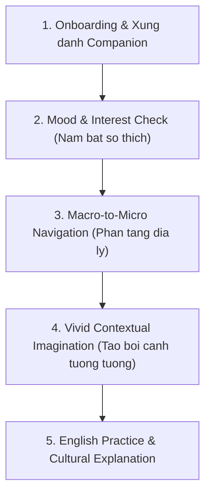
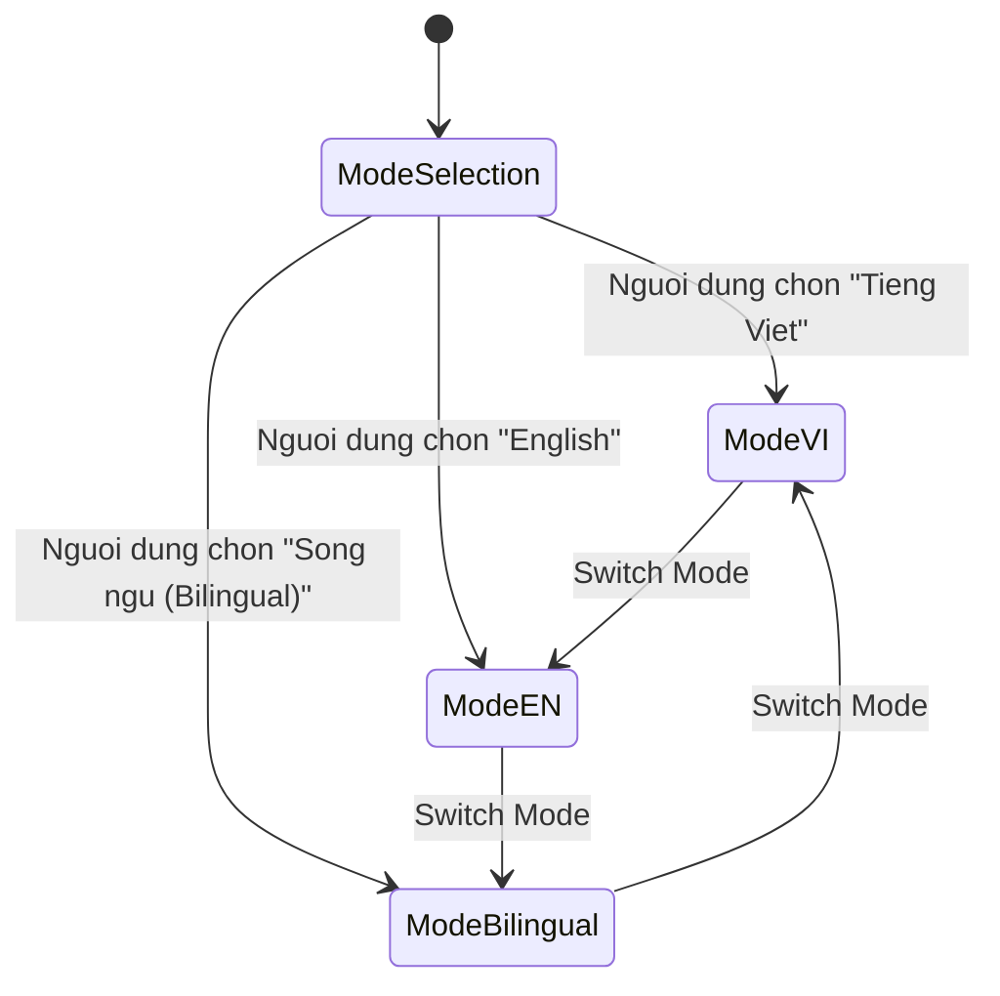
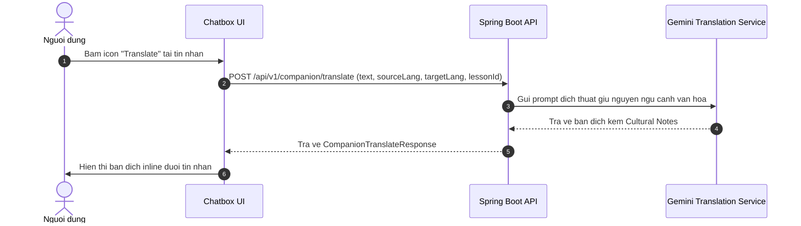

# Luong Hoi Thoai va Trai Nghiem Dam Thoai AI (Conversational Flows)

## 1. Phu Thuoc va Ke Thua (Dependencies)
- Ke thua Interface: `interface_ai_companion.md`
- Tham chieu Du lieu: `system_data_dictionary.md` (`ReadingPost.summary`)
- Tham chieu Kien truc va API: `context_retrieval_chat.md`
- Can cu thuc te: Buoi hop ky thuat ngay 14/10/2026 va yeu cau bo sung tinh nang Bilingual & Chat History Persistence ngay 25/10/2026.

---

## 2. Luong Hoi Thoai Chuan (Standard Dialogue Lifecycle)

### Buoc 1: Mo dau luong (Onboarding & Identity)
- AI luon chu dong xung danh va khang dinh ro vai tro la "Nguoi ban dong hanh van hoa Viet Nam".
- Tranh phong cach tro ly hanh chinh tho rap; dung ngon tu am ap, ton vinh ban sac.

### Buoc 2: Nam bat tam trang va so thich (Mood & Interest Check)
- AI khong do don kien thuc ngay ma dat 1-2 cau hoi mo de lang nghe tam trang hien tai cua nguoi hoc.
  - Vi du: "Hom nay ban thay the nao? Ban dang them mot mon an nong hoi mien Bac hay muon nghe ve mot truyen thuyet bien dao mien Trung?"
- Goi y 3 nhom chu de chinh: Am thuc (Cuisine), Di san (Heritage), Lang nghe truyen thong (Handicrafts).

### Buoc 3: Phan tang thong tin (Macro to Micro Navigation)
- Dieu huong cuoc tro chuyen tu vung vi mo xuong vi mo cuc ky chi tiet:
  - Vi mo: Vung Nam Bo -> Thanh pho Ho Chi Minh.
  - Vi mo: Cho hoa Tet Ben Binh Dong, quan ca phe vot lau nam o quan 5.

### Buoc 4: Tao boi canh trai nghiem sinh dong (Contextual Imagination)
- Kich thich phan xa tu duy bang cach yeu cau nguoi hoc tuong tuong:
  - Vi du: "Imagine you are sitting on a small plastic stool by the sidewalk on a rainy afternoon, holding a warm bowl of Pho..."
- Giup nguoi hoc tu tin dung tieng Anh dien dat cam xuc chan that thay vi hoc vet.

### Buoc 5: Luyen tap tieng Anh va giai thich van hoa (English Practice & Cultural Explanation)
- Phan hoi cua AI can can bang giua yeu to van hoa va ngon ngu hoc thuat:
  - Giai thich y nghia sau xa cua phong tuc tap quan.
  - Bo sung phan chu thich tu vung tieng Anh quan trong xuat hien trong cau tra loi (kem phien am va vi du).
  - Dat 1 cau hoi mo o cuoi tin nhan de giu chan nguoi dung tiep tuc hoi thoai.

---

## 3. Luong Chuyen Doi Ngon Ngu Hoi Thoai (Bilingual AI Companion Flow)

He thong ho tro 3 che do ngon ngu tuy chinh linh hoat trong suot phien hoi thoai:

### 3.1. Dinh nghia cac che do ngon ngu
- **Che do Tieng Viet (`vi`):**
  - AI phan hoi 100% bang tieng Viet tu nhien, giau ban sac.
  - Muc tieu: Phu hop cho nguoi dung muon tim hieu sau ve van hoa ma khong bi rao can ngon ngu, hoac nguoi moi bat dau.
  - Cac thuat ngu tieng Anh van duoc ghi chu trong ngoac don khi can thiet.
- **Che do Tieng Anh (`en`):**
  - AI phan hoi 100% bang tieng Anh chuan CEFR A2-B2, tu ngu ro rang, dien dat tu nhien.
  - Muc tieu: Phu hop cho nguoi dung muon tam minh trong moi truong luyen tap tieng Anh hoac nguoi nuoc ngoai muon kham pha van hoa Viet Nam.
- **Che do Song ngu (`bilingual` - Mac dinh):**
  - AI phan hoi theo ket cau song ngu song song hoac chia tach doan (Paragraph VI - Paragraph EN).
  - Giup nguoi hoc doi chieu ngay lap tuc cach dien dat van hoa Viet bang ngon ngu quoc te.

### 3.2. Luong Dich Thuat Tuc Thi (Inline Cultural Translation Flow)
- Nguoi dung co the nhan vao nut "Dich" (Translate) tai bat ky bong bong chat nao (tin nhan cua nguoi dung hoac cua AI).
- Khong phai dich may thong thuong (Google Translate tho rap), he thong su dung Cultural Contextual Translation Prompt qua Gemini API de giu nguyen hon cot, dien giai thanh ngu, ten mon an, danh lam thang canh.
- Ket qua dich hien thi ngay ben duoi tin nhan goc va co the dong/mo tuy y.

---

## 4. Quan Ly Phien va Luu Tru Lich Su Tro Chuyen (Chat History Persistence)

He thong phan tach ro rang giua 2 nhom doi tuong: Khach vang lai (Guest) va Nguoi dung da xac thuc (Authenticated User).

### 4.1. Khach vang lai (Guest / Anonymous)
- **Kenh luu tru:** Browser `localStorage`.
- **Khoa luu tru:** `viecultures_chat_history_guest_{lessonId|global}`.
- **Han muc:** Toi da 3 luot hoi thoai / ngay (theo doi qua LocalStorage va Client Fingerprint / IP Cache).
- **Vong doi:** Du lieu duy tri tren trinh duyet hien tai. Khi sang thiet bi khac, phien chat khong duoc dong bo.
- **Bao mat:** Khong luu tru thong tin nhay cam.

### 4.2. Nguoi dung da xac thuc (Authenticated User)
- **Kenh luu tru:** PostgreSQL Database (`companion_chat_sessions`, `companion_chat_messages`).
- **Phan loai phien (Session Scope):**
  - `LESSON_SCOPED`: Gan lien voi mot `lessonId` cu the.
  - `GLOBAL`: Phien hoi thoai tu do tren trang chu / ban do kham pha.
- **Dong bo da thiet bi (Cross-device Sync):** Nguoi dung dang nhap o thiet bi bat ky deu xem lai duoc toan bo lich su chat.
- **Quyen rieng tu:** Cach ly du lieu triet de theo `userId`, chi chu so huu phien moi co quyen doc hoac xoa.

### 4.3. Luong Hop Nhat Du Lieu Khi Dang Nhap (Guest-to-User Merge Flow)
- Khi khach vang lai dang tro chuyen va quyet dinh dang nhap:
  1. Frontend kiem tra xem co tin nhan guest nao trong `localStorage` chua duoc dong bo.
  2. Neu co, frontend goi `POST /api/v1/companion/history` gui toan bo mang tin nhan guest len backend kem JWT Token.
  3. Backend tao phien chat moi trong database va luu toan bo tin nhan nay vao tai khoan nguoi dung.
  4. Frontend xoa sach du lieu guest trong `localStorage` de tranh trung lap.

### 4.4. Luong Xoa Lich Su Tro Chuyen (Chat History Deletion)
- Nguoi dung co quyen:
  - Xoa lich su cua mot phien bai hoc cu the (`DELETE /api/v1/companion/history?lessonId=xxx`).
  - Xoa toan bo tat ca lich su tro chuyen tren he thong (`DELETE /api/v1/companion/history?lessonId=all`).
- Backend thuc hien xoa mem (soft-delete) hoac xoa vat ly (hard-delete) tuy theo cau hinh luu tru, va lam moi cache.

---

## 5. Tieu Chi Nghiem Thu (Acceptance Criteria - Given-When-Then)

### Kich ban 1: Chuyen doi che do ngon ngu trong phien hoi thoai
- **Given:** Nguoi dung dang mo hop thoai AI Companion o bat ky che do nao.
- **When:** Nguoi dung chon che do ngon ngu moi ('vi', 'en', hoac 'bilingual') tu thanh cong cu chat.
- **Then:**
  - Request tiep theo gui len `POST /api/v1/companion/chat` phai chua truong `language` tuong ung.
  - AI phan hoi theo dung dinh dang ngon ngu duoc yeu cau.
  - UI luu lai lua chon ngon ngu nay cho cac luot chat tiep theo cua phien.

### Kich ban 2: Dich thuat inline tin nhan van hoa
- **Given:** Co it nhat 1 tin nhan hien thi trong khung chat.
- **When:** Nguoi dung nhan vao nut dich ben canh tin nhan.
- **Then:**
  - He thong goi `POST /api/v1/companion/translate`.
  - Hien thi trang thai loading inline tai tin nhan do.
  - Khi API tra ve thanh cong, ban dich va ghi chu van hoa (neu co) hien thi ro rang ben duoi tin nhan goc.

### Kich ban 3: Luu tru va dong bo lich su chat cho nguoi dung dang nhap
- **Given:** Nguoi dung da dang nhap voi Bearer Token hop le.
- **When:** Nguoi dung gui tin nhan va nhan phan hoi tu AI.
- **Then:**
  - Backend tu dong ghi nhan ca cau hoi cua user va cau tra loi cua AI vao bang `companion_chat_messages`.
  - Khi nguoi dung F5 tai lai trang hoac dang nhap tren thiet bi khac, goi `GET /api/v1/companion/history` tra ve dung danh sach tin nhan da trao doi theo thu tu thoi gian.

### Kich ban 4: Xoa lich su tro chuyen
- **Given:** Nguoi dung dang xem lich su chat cua mot bai hoc.
- **When:** Nguoi dung nhan nut "Xoa lich su tro chuyen" va xac nhan hop thoai canh bao.
- **Then:**
  - He thong goi `DELETE /api/v1/companion/history?lessonId={lessonId}`.
  - Khung chat duoc lam sach tro ve trang thai ban dau voi tin nhan chao don.
  - Goi lai `GET /api/v1/companion/history` se tra ve danh sach rong.
