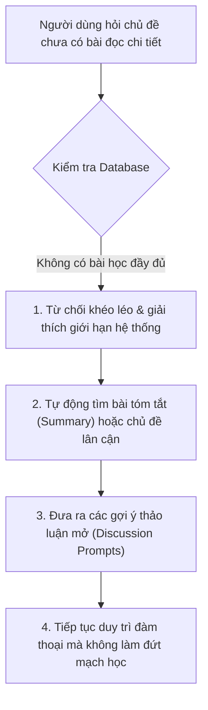

# 🛡️ Cơ Chế Xử Lý Ngoại Lệ & Dự Phòng (Fallback Mechanisms)

## 1. Phụ Thuộc & Kế Thừa (Dependencies)
- Kế thừa Interface: [`interface_ai_companion.md`](./interface_ai_companion.md)
- Tham chiếu Ngoại lệ: [`edge_cases_and_validation.md`](../00_core/edge_cases_and_validation.md) (`EC-05.1`, `EC-05.2`, `EC-05.3`)
- Căn cứ thực tế: Nghị quyết kỹ thuật ghi nhận trong `record-meeting.md`.

---

## 2. Bối Cảnh & Hạn Chế Hệ Thống Hiện Tại

1. **Kho dữ liệu chưa phủ kín 100%:** Trong giai đoạn pilot hiện tại, hệ thống tập trung hoàn thiện 15 bài đọc mẫu trọng tâm. Một số địa danh hoặc chủ đề người dùng truy vấn có thể chưa có sẵn bài học hoàn chỉnh (`ReadingPost`).
2. **Khung chat không phải nơi đọc bài báo dài:** Giao diện hội thoại được thiết kế tối ưu cho đàm thoại tương tác ngắn, không hỗ trợ việc hiển thị toàn bộ bài viết dài hàng trăm từ để người dùng tự đọc lướt.

---

## 3. Quy Trình Xử Lý Ngoại Lệ Khéo Léo (Graceful Fallback Workflow)

### Chi Tiết Từng Bước Thực Thi:

1. **Từ chối khéo léo (Graceful Refusal):**
   - AI lập trình để không bao giờ báo lỗi kỹ thuật hệ thống khô cứng (như *"404 Not Found"* hoặc *"Lỗi cơ sở dữ liệu"*).
   - AI giải thích chân thành:
     > *"Chủ đề này rất thú vị! Hiện tại kho tư liệu chi tiết của VieCultures đang tiếp tục được mở rộng nên bài học đầy đủ về chủ đề này chưa sẵn sàng..."*
2. **Khai thác nội dung tóm tắt (Summary Utilization):**
   - AI sử dụng trường `summary` hoặc kiến thức tổng quát được duyệt trước để cung cấp 1 đoạn tóm tắt văn hóa ngắn gọn (3–4 câu).
3. **Cung cấp gợi ý thảo luận (Discussion Prompts):**
   - Ngay sau đoạn tóm tắt, AI chủ động đưa ra 2–3 câu hỏi thảo luận mở để người học tiếp tục tương tác:
     - *Prompt 1:* *"Have you ever tried this dish or visited this place before?"*
     - *Prompt 2:* *"How would you describe this tradition to a foreign friend in one sentence?"*
4. **Điều hướng mở bài đọc (Reader Redirection):**
   - Nếu người dùng nằng nặc đòi đọc bài hoàn chỉnh, AI cung cấp link dẫn trực tiếp sang các bài đọc sẵn sàng trong danh mục Reader (`/lessons/:id`) để trải nghiệm trên màn hình 2 cột chuyên dụng.
