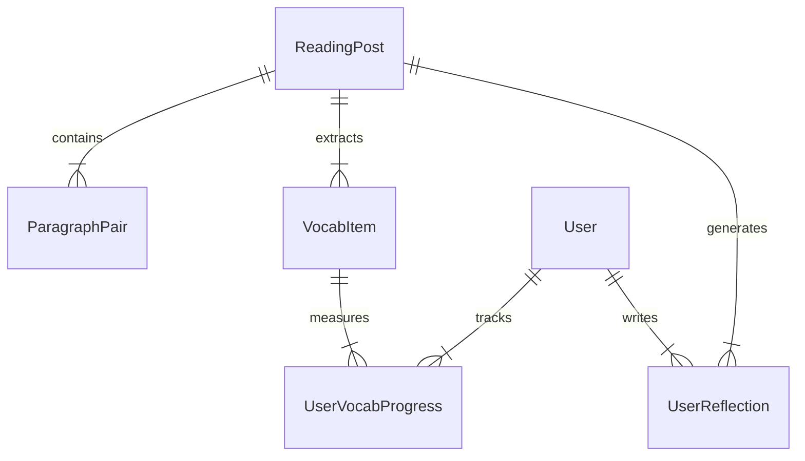

# 🗄️ Từ Điển Dữ Liệu Hệ Thống (System Data Dictionary)

Tài liệu quy định cấu trúc dữ liệu, các thực thể (Entities), thuộc tính (Attributes) và mối quan hệ (Relationships) dùng cho Database Schema và API Contracts giữa FE/BE/AI Agents.

---

## 1. Sơ Đồ Thực Thể Quan Hệ (ERD Concept)

> Xem sơ đồ thực thể quan niệm tổng thể (Conceptual Data Model - không thuộc tính) tại: [conceptual-diagram.md](../conceptual-diagram.md) | File Mermaid: [conceptual-diagram.mmd](../conceptual-diagram.mmd)

---

## 2. Thực Thể `ReadingPost` (Bài Đọc)

| Trường (Field) | Kiểu dữ liệu | Mô tả & Quy tắc |
| :--- | :--- | :--- |
| `id` | `String` (UUID) | Khóa chính của bài đọc. |
| `topic_group` | `String` | **Cụm chủ đề / Nhóm bài**: Tên câu chuyện văn hóa chung để gom các phiên bản đa cấp độ (ví dụ: *"Tục kéo vợ người Mông"*, *"Chợ tình Khâu Vai"*). Cho phép chuyển đổi linh hoạt các cấp độ (Level 1, 2, 3) trên cùng một bài học. |
| `title_en` | `String` | Tiêu đề tiếng Anh của bài đọc theo cấp độ (TITLE). |
| `title_vi` | `String` | Tiêu đề tiếng Việt dịch tương ứng. |
| `topic` | `String` | Thể loại chuyên mục (ví dụ: *Phong tục tập quán, Lễ hội, Di sản, Ẩm thực...*). |
| `region` | `String` | **Vùng miền / Tỉnh thành**: Địa danh văn hóa gắn liền với bài viết (ví dụ: *Lào Cai, Tuyên Quang, Đắk Lắk, Phú Thọ...*). Phục vụ tính năng lọc "Bốn miền khám phá". |
| `level` | `Enum` | Trình độ bài đọc (`A1`, `A2`, `B1`, `B2`, `C1`, `C2`). Khớp với cột Level 1 (A1), Level 2 (B1), Level 3 (B2/C1). |
| `word_count` | `Integer` | **Số lượng từ**: Độ dài bài đọc tiếng Anh (ví dụ: 89, 238, 415 words). Dùng để tính tốc độ đọc và hiển thị cho người học. |
| `read_time` | `String` | Thời lượng đọc ước tính (ví dụ: *"2 mins"*, *"5 mins"*). |
| `summary` | `Text` | Tóm tắt ngắn gọn nội dung bài đọc. |
| `content_en` | `Text` | Toàn văn bài đọc tiếng Anh (`ENGLISH READING`). |
| `content_vi` | `Text` | Toàn văn bài dịch tiếng Việt (`VIETNAMESE TRANSLATION`). |
| `image_url` | `String` (URL) | Hình ảnh minh họa bài đọc văn hóa. |
| `shadowing_audio_url` | `String` (URL) | Đường dẫn file âm thanh AI Shadowing đọc toàn bộ bài đọc. |
| `total_reads` | `Integer` | Số lượt người học đã truy cập bài. |
| `likes_count` | `Integer` | Số lượt yêu thích bài đọc. |
| `created_at` | `Timestamp` | Thời gian tạo bài đọc. |

---

## 3. Thực Thể `ParagraphPair` (Cặp Đoạn Song Ngữ)

| Trường (Field) | Kiểu dữ liệu | Mô tả & Quy tắc |
| :--- | :--- | :--- |
| `id` | `String` (UUID) | ID đoạn văn. |
| `post_id` | `String` (FK) | Mã liên kết với `ReadingPost`. |
| `order_index` | `Integer` | Thứ tự đoạn văn trong bài đọc (0, 1, 2...). |
| `en_text` | `Text` | Văn bản đoạn tiếng Anh (Dữ liệu chính). |
| `vi_text` | `Text` | Văn bản đoạn tiếng Việt (Dữ liệu phụ trợ). |
| `audio_timestamp_start` | `Float` | Mốc giây bắt đầu trong file audio bài đọc. |
| `audio_timestamp_end` | `Float` | Mốc giây kết thúc trong file audio bài đọc. |

---

## 4. Thực Thể `VocabItem` (Từ Vựng & Cụm Từ Ngữ Cảnh)

| Trường (Field) | Kiểu dữ liệu | Mô tả & Quy tắc |
| :--- | :--- | :--- |
| `id` | `String` (UUID) | ID từ vựng. |
| `post_id` | `String` (FK) | Mã liên kết với bài đọc xuất bản từ này. |
| `word` | `String` | **Từ gốc hoặc cụm từ** tiếng Anh (`Word / Phrase`, ví dụ: *tradition*, *marriage custom*, *expensive gifts*). |
| `ipa` | `String` | Phiên âm quốc tế IPA (cho phép nullable, có thể sinh tự động bởi AI). |
| `pos` | `String` | Từ loại (*noun, verb, adj, phrase...* - cho phép nullable lúc import ban đầu). |
| `vi_meaning` | `String` | Nghĩa tiếng Việt tương ứng (`Nghĩa tiếng Việt`). |
| `context_sentence` | `Text` | Câu tiếng Anh trong bài đọc chứa từ/cụm từ này (cho phép trích xuất tự động khi import bài). |
| `audio_url` | `String` (URL) | File phát âm từ vựng đơn lẻ. |
| `level` | `Enum` | Trình độ CEFR của từ (`A1` đến `C2`). |
| `usage_note` | `Text` | Ghi chú ngữ cảnh sử dụng văn hóa hoặc ngữ pháp. |

---

## 5. Thực Thể `UserReflection` (Cảm Nghĩ Người Dùng - UGC)

| Trường (Field) | Kiểu dữ liệu | Mô tả & Quy tắc |
| :--- | :--- | :--- |
| `id` | `String` (UUID) | ID bài viết cảm nghĩ. |
| `user_id` | `String` (FK) | Mã người tạo bài viết. |
| `post_id` | `String` (FK) | Bài đọc liên quan. |
| `content` | `Text` | Nội dung cảm nghĩ của người dùng. |
| `used_vocab_ids` | `Array[String]` | Danh sách ID từ vựng đã chèn/nhận diện được trong bài. |
| `reactions_count` | `Integer` | Số lượt thả tim / tương tác (mặc định = 0). |
| `status` | `Enum` | `published` (Đăng ngay) \| `pending_review` (Do chứa từ nhạy cảm). |
| `created_at` | `Timestamp` | Thời gian đăng. |

---

## 6. Thực Thể `UserVocabProgress` (Tiến Độ Flashcard)

| Trường (Field) | Kiểu dữ liệu | Mô tả & Quy tắc |
| :--- | :--- | :--- |
| `user_id` | `String` (FK) | ID người dùng. |
| `vocab_id` | `String` (FK) | ID từ vựng. |
| `status` | `Enum` | `learning` (Cần ôn lại) \| `mastered` (Đã nhớ). |
| `review_count` | `Integer` | Số lần đã lật ôn tập. |
| `last_reviewed_at` | `Timestamp` | Thời điểm đánh giá nhị phân gần nhất. |
