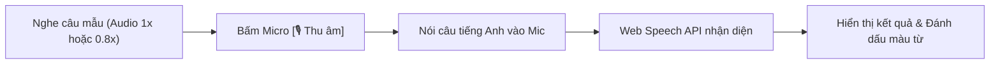

# 🗣️ Phản Hồi Phát Âm & Đánh Giá Giọng Đọc (Pronunciation Feedback)

## 1. Phụ Thuộc & Kế Thừa (Dependencies)
- Kế thừa Interface: [`interface_speaking.md`](./interface_speaking.md)
- Tham chiếu Dữ liệu: [`system_data_dictionary.md`](../00_core/system_data_dictionary.md) (`ParagraphPair`)

---

## 2. Quy Trình Thu Âm & Phản Hồi Giọng Đọc

### Chi Tiết Tương Tác:

1. **Hiển thị câu mẫu:**
   - Câu tiếng Anh trích từ bài đọc, có phiên âm IPA của các từ học thuật.
   - Có nút loa nhỏ bên cạnh để người học nghe lại phát âm mẫu ở tốc độ `1x` hoặc `0.8x`.
2. **Kích hoạt thu âm:**
   - Nút Micro tròn lớn `[🎙️ Thu âm]`. Khi bấm, trình duyệt yêu cầu cấp quyền microphone và hiển thị sóng âm chuyển động (Audio visualizer).
   - Bấm lần nữa để hoàn thành hoặc tự động ngắt sau 3 giây im lặng.
3. **Phản hồi màu sắc trực quan (Color-Coded Feedback):**
   - **Màu Xanh lá (`#2F855A`):** Từ phát âm rõ ràng, khớp với văn bản mẫu.
   - **Màu Vàng Cam (`#DD6B20`):** Từ bị phát âm lệch âm tiết, nuốt âm hoặc bỏ sót.
4. **Thang điểm khích lệ (Encouraging Metric):**
   - Tính toán tỷ lệ phần trăm từ đọc chuẩn: `(Số từ đúng / Tổng số từ) * 100%`.
   - Lời động viên: *"Tuyệt vời! Bạn đã phát âm chuẩn 5/6 từ"*, giúp người học tự tin rèn luyện tiếp mà không mang áp lực điểm số tiêu cực.
