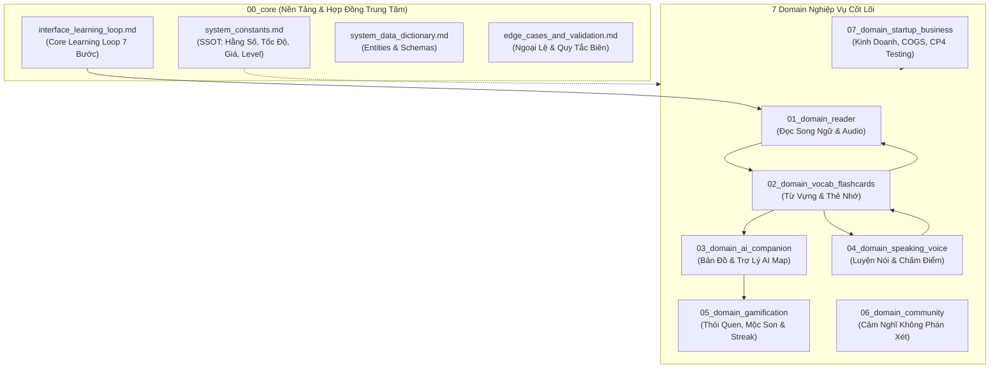
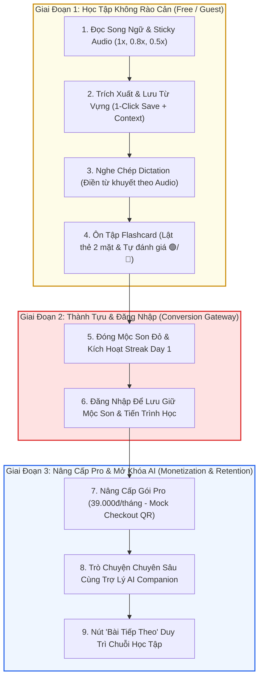

# VieCultures – Hệ Thống Tài Liệu Kiến Trúc Hướng Đối Tượng (OOP Docs Architecture)

> **Dự án:** VieCultures  
> **Slogan / Tagline:** *"Learn the language. Tell the culture."* (Gom từng từ nhỏ, hiểu một Việt Nam lớn)  
> **Khách hàng mục tiêu:** Sinh viên đại học và người trẻ Việt Nam 18–24 tuổi (CEFR A2–B2)  
> **Giai đoạn hiện tại:** Hoàn thiện Interactive Prototype Web Demo (CP3) & Chuẩn bị User Testing (>=20 testers), Financial Forecast (2027–2029) cho Checkpoint 4 (CP4) – Capstone Startup Project (Kỳ 7, EXE101)  
> **Link Web Demo:** [https://frontend-olive-chi-8de2fo4jbr.vercel.app/](https://frontend-olive-chi-8de2fo4jbr.vercel.app/)

Tài liệu được tổ chức theo **Kiến Trúc Hướng Đối Tượng (OOP-Style Documentation)** tối ưu hóa cho AI Coding Agent và đội ngũ liên ngành (Kinh doanh, Kỹ thuật, Marketing). Cấu trúc phân tách rõ ràng giữa **Core Contracts**, **Domain Interfaces** và **Child Implementations**, triệt tiêu trùng lặp dữ liệu và bảo đảm Single Source of Truth (SSOT).

---

## 🗺️ Sơ Đồ Kiến Trúc Hệ Thống (OOP Domain Architecture)

---

## 🚀 Luồng Chính Của Sản Phẩm (End-to-End Product Main Flow)

Luồng trải nghiệm chính của VieCultures được chuẩn hóa theo mô hình liên hoàn **3 Giai Đoạn – 9 Chặng (7–10 phút/chu trình)**, giải quyết bài toán trải nghiệm học tập không rào cản và chốt chuyển đổi kinh doanh cho Startup:

> 📖 **Chi tiết hợp đồng dữ liệu & phân loại khảo sát:** Xem tài liệu chuẩn SSOT tại [`interface_learning_loop.md`](./00_core/interface_learning_loop.md).

---

## 📂 Bảng Tra Cứu Các Domain Nghiệp Vụ (Domain Index)

| Thư Mục Domain | Interface Cha (Contract) | Các File Triển Khai Con (Implementations) | Trách Nhiệm Chính |
| :--- | :--- | :--- | :--- |
| **`00_core/`** | [`interface_learning_loop.md`](./00_core/interface_learning_loop.md) | • [`system_constants.md`](./00_core/system_constants.md) • [`system_data_dictionary.md`](./00_core/system_data_dictionary.md) • [`edge_cases_and_validation.md`](./00_core/edge_cases_and_validation.md) | **Nguồn chân lý duy nhất (SSOT)**: Định nghĩa hằng số hệ thống, chu trình học tập 7 bước, lược đồ dữ liệu và xử lý ngoại lệ toàn hệ thống. |
| **`01_domain_reader/`** | [`interface_reader.md`](./01_domain_reader/interface_reader.md) | • [`paragraph_pairing.md`](./01_domain_reader/paragraph_pairing.md) • [`natural_audio_dictation.md`](./01_domain_reader/natural_audio_dictation.md) • [`editorial_guidelines.md`](./01_domain_reader/editorial_guidelines.md) | Đọc song ngữ cặp đoạn 1:1, Sticky Player dải tốc độ `[1x, 0.8x, 0.5x]`, nghe chép Dictation và chuẩn biên tập văn hóa bền vững 3 Level. |
| **`02_domain_vocab_flashcards/`**| [`interface_vocab.md`](./02_domain_vocab_flashcards/interface_vocab.md) | • [`context_extraction.md`](./02_domain_vocab_flashcards/context_extraction.md) • [`spaced_repetition.md`](./02_domain_vocab_flashcards/spaced_repetition.md) | Tra cứu tooltip tức thì, 1-Click Save bắt buộc gắn `context_sentence`, thẻ nhớ 2 mặt và tự đánh giá nhị phân 🟢/🔴. |
| **`03_domain_ai_companion/`** | [`interface_ai_companion.md`](./03_domain_ai_companion/interface_ai_companion.md) | • [`conversational_flows.md`](./03_domain_ai_companion/conversational_flows.md) • [`fallback_mechanisms.md`](./03_domain_ai_companion/fallback_mechanisms.md) | Bản đồ khám phá văn hóa tương tác, trợ lý AI Google Gemini, đàm thoại phân tầng Macro-to-Micro và cơ chế Fallback (Summary + Prompts). |
| **`04_domain_speaking_voice/`** | [`interface_speaking.md`](./04_domain_speaking_voice/interface_speaking.md) | • [`pronunciation_feedback.md`](./04_domain_speaking_voice/pronunciation_feedback.md) | Thu âm qua Web Speech API, so khớp chuỗi từ thời gian thực, đánh dấu màu phát âm đúng/sai và thang điểm khích lệ. |
| **`05_domain_gamification/`** | [`interface_gamification.md`](./05_domain_gamification/interface_gamification.md) | • [`habit_tracking.md`](./05_domain_gamification/habit_tracking.md) | Chuỗi ngày học liên tục (Daily Streak), nghi thức đóng Mộc son văn hóa và thẻ nhận xét từ Mascot đồng hành. |
| **`06_domain_community/`** | [`interface_community.md`](./06_domain_community/interface_community.md) | • [`reflections_moderation.md`](./06_domain_community/reflections_moderation.md) | Cảm nghĩ cộng đồng (Reflections UGC), chính sách Không phán xét ngữ pháp và bộ lọc kiểm duyệt thụ động. |
| **`07_domain_startup_business/`**| [`interface_business.md`](./07_domain_startup_business/interface_business.md) | • [`market_validation.md`](./07_domain_startup_business/market_validation.md) • [`financial_model_cogs.md`](./07_domain_startup_business/financial_model_cogs.md) • [`cp4_user_testing_plan.md`](./07_domain_startup_business/cp4_user_testing_plan.md) | Phân tầng Free vs Premium Trial 7 ngày, khảo sát 81 mẫu CP2, dự phóng tài chính 2027–2029 (COGS server/API) và kế hoạch test 20+ người dùng CP4. |

---

## 🛠️ Hướng Dẫn Quy Trình Làm Việc (Workflow Cho Agent & Developer)

1. **Khi nhận một tác vụ mới:**
   - Mở [`README.md`](./README.md) để xác định tính năng thuộc Domain nào.
   - Mở `interface_<domain>.md` của domain đó để nắm rõ hợp đồng props/events và các file con liên quan.
   - Mở file triển khai cụ thể để thực hiện sửa đổi mã nguồn.
2. **Quy tắc Single Source of Truth:**
   - Tuyệt đối không tự hardcode các hằng số (tốc độ đọc, bảng giá, level, vùng miền) ở các file con. Luôn tham chiếu về [`system_constants.md`](./00_core/system_constants.md).
3. **Khi bổ sung hoặc thay đổi tính năng:**
   - Khai báo cập nhật ở file con triển khai trước.
   - Đồng bộ lại Interface cha nếu có thay đổi về hợp đồng/API.

---

## 👥 Đội Ngũ Sáng Lập (Team VieC)

| Thành viên | Chuyên ngành | Vai trò trong dự án |
| :--- | :--- | :--- |
| **Trần Nguyễn Minh Bảo** | Kinh doanh Quốc tế | Trưởng nhóm / Chiến lược Sản phẩm, Mô hình Kinh doanh & Vận hành |
| **Ninh Thiện Luân** | Kỹ thuật Phần mềm | Phát triển Kiến trúc Frontend, Web Demo & Trải nghiệm AI Map |
| **Nguyễn Phú Cường** | Kỹ thuật Phần mềm | Lập trình Fullstack, Tích hợp Dịch vụ Backend & Vận hành Kỹ thuật |
| **Nguyễn Thị Thảo Tâm** | Marketing | Nghiên cứu Khách hàng Mục tiêu, Phân tích Đối thủ & Business Model Canvas |
| **Phan Phục Trinh** | Marketing | Quản lý Nội dung Song ngữ 3 Miền, Chuẩn hóa Văn hóa & Marketing Plan (7P) |
| **Nguyễn Trung Nam** | Marketing | Nghiên cứu Thị trường, Kế hoạch Thu hút Khách hàng & Marketing Plan (7P) |
