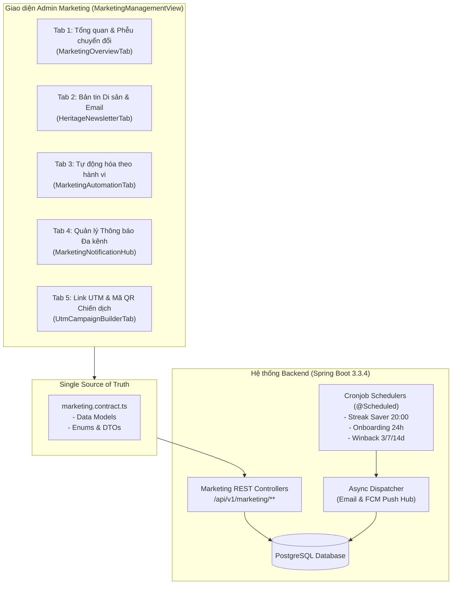

# Đặc tả Kỹ thuật Hệ thống Tăng trưởng & Giữ chân Học viên (Growth & Retention Engine)

Tài liệu này chuẩn hóa toàn bộ kiến trúc Phân hệ Marketing & Tăng trưởng của [VieCultures](https://viecultures.app/) từ tầng Giao diện (Frontend), Hợp đồng dữ liệu (Data Contract) đến Thiết kế Cơ sở dữ liệu và Cơ chế Xử lý Ngầm (Backend Spring Boot 3.3.4 & PostgreSQL).

---

## 1. Cấu trúc 5 Sub-Tabs Nghiệp vụ



---

## 2. Thiết kế Cơ sở Dữ liệu (PostgreSQL Schema)

### 2.1 Bảng `marketing_campaigns` (Chiến dịch Bản tin & UTM)
```sql
CREATE TABLE marketing_campaigns (
    id VARCHAR(64) PRIMARY KEY,
    name VARCHAR(255) NOT NULL,
    campaign_type VARCHAR(32) NOT NULL, -- 'NEWSLETTER', 'UTM_LINK', 'PROMOTION'
    channel VARCHAR(32) NOT NULL,        -- 'EMAIL', 'FACEBOOK', 'TIKTOK', 'GOOGLE', 'ZALO'
    target_segment VARCHAR(64) NOT NULL, -- 'ALL_USERS', 'FREE_TIER', 'INTEREST_NORTH', etc.
    target_path VARCHAR(255),
    full_url TEXT,
    short_url VARCHAR(255),
    utm_source VARCHAR(64),
    utm_medium VARCHAR(64),
    utm_campaign VARCHAR(128),
    utm_content VARCHAR(128),
    status VARCHAR(32) DEFAULT 'DRAFT',  -- 'DRAFT', 'SCHEDULED', 'SENT', 'CANCELLED'
    scheduled_at TIMESTAMP WITH TIME ZONE,
    sent_at TIMESTAMP WITH TIME ZONE,
    clicks_count INT DEFAULT 0,
    leads_count INT DEFAULT 0,
    conversions_count INT DEFAULT 0,
    revenue_vnd BIGINT DEFAULT 0,
    created_at TIMESTAMP WITH TIME ZONE DEFAULT CURRENT_TIMESTAMP,
    updated_at TIMESTAMP WITH TIME ZONE DEFAULT CURRENT_TIMESTAMP
);

CREATE INDEX idx_campaigns_status ON marketing_campaigns(status);
CREATE INDEX idx_campaigns_type ON marketing_campaigns(campaign_type);
```

### 2.2 Bảng `marketing_automation_workflows` (5 Kịch bản Tự động hóa)
```sql
CREATE TABLE marketing_automation_workflows (
    id VARCHAR(64) PRIMARY KEY,
    title VARCHAR(255) NOT NULL,
    trigger_key VARCHAR(64) NOT NULL UNIQUE, 
    -- 'ONBOARDING_INCOMPLETE_24H', 'STREAK_SAVER_20H', 'SPACED_REPETITION_DUE', 'WINBACK_7D', 'PAYWALL_AUDIO_LIMIT_REACHED'
    target_goal VARCHAR(128) NOT NULL,
    channels VARCHAR(64)[] NOT NULL,         -- ARRAY['EMAIL', 'IN_APP', 'WEB_PUSH', 'MOBILE_PUSH']
    is_active BOOLEAN DEFAULT TRUE,
    frequency_capping_hours INT DEFAULT 24,
    template_subject VARCHAR(255),
    template_headline VARCHAR(255) NOT NULL,
    template_body TEXT NOT NULL,
    action_deep_link VARCHAR(255) NOT NULL,
    action_text VARCHAR(64) NOT NULL,
    triggered_count INT DEFAULT 0,
    converted_count INT DEFAULT 0,
    last_triggered_at TIMESTAMP WITH TIME ZONE,
    created_at TIMESTAMP WITH TIME ZONE DEFAULT CURRENT_TIMESTAMP,
    updated_at TIMESTAMP WITH TIME ZONE DEFAULT CURRENT_TIMESTAMP
);
```

### 2.3 Bảng `marketing_automation_logs` (Nhật ký Thực thi Tự động)
```sql
CREATE TABLE marketing_automation_logs (
    id VARCHAR(64) PRIMARY KEY,
    workflow_id VARCHAR(64) REFERENCES marketing_automation_workflows(id) ON DELETE CASCADE,
    user_id VARCHAR(64) NOT NULL,
    channel VARCHAR(32) NOT NULL,
    delivery_status VARCHAR(32) NOT NULL, -- 'DELIVERED', 'FAILED', 'CONVERTED'
    executed_at TIMESTAMP WITH TIME ZONE DEFAULT CURRENT_TIMESTAMP,
    conversion_at TIMESTAMP WITH TIME ZONE
);

CREATE INDEX idx_automation_logs_workflow ON marketing_automation_logs(workflow_id);
CREATE INDEX idx_automation_logs_user ON marketing_automation_logs(user_id);
CREATE INDEX idx_automation_logs_time ON marketing_automation_logs(executed_at);
```

### 2.4 Bảng `marketing_frequency_capping` (Kiểm soát Chống làm phiền)
```sql
CREATE TABLE marketing_frequency_capping (
    user_id VARCHAR(64) PRIMARY KEY,
    daily_notification_count INT DEFAULT 0,
    last_notified_at TIMESTAMP WITH TIME ZONE,
    reset_date DATE DEFAULT CURRENT_DATE
);
```

---

## 3. Cơ chế Lên lịch & Chạy ngầm (Spring Boot Schedulers)

Hệ thống sử dụng các tác vụ chạy định kỳ kết hợp truy vấn tối ưu trên cơ sở dữ liệu:

### 3.1 Kịch bản 1: Chuỗi chào mừng (Onboarding Kickoff)
- **Tần suất quét:** Mỗi 1 giờ (`@Scheduled(cron = "0 0 * * * *")`).
- **Điều kiện:**
  ```sql
  SELECT u.id, u.email, u.full_name 
  FROM users u
  LEFT JOIN user_reading_progress p ON u.id = p.user_id AND p.is_completed = true
  WHERE u.created_at <= NOW() - INTERVAL '24 HOURS'
    AND u.created_at >= NOW() - INTERVAL '25 HOURS'
    AND p.id IS NULL
    AND NOT EXISTS (
        SELECT 1 FROM marketing_automation_logs l 
        WHERE l.user_id = u.id AND l.workflow_id = 'wf-onboarding-24h'
    );
  ```

### 3.2 Kịch bản 2: Cứu chuỗi ngày học (Streak Saver 20:00)
- **Tần suất quét:** 20:00 hàng ngày (`@Scheduled(cron = "0 0 20 * * *")`).
- **Điều kiện:** Học viên có `current_streak >= 3` nhưng chưa có hoạt động học trong ngày hôm nay (`last_study_date < CURRENT_DATE`).
- **Kênh:** Firebase Cloud Messaging (Web Push & Mobile Push).

### 3.3 Kịch bản 3: Nhắc ôn tập ngắt quãng (Spaced Repetition Due)
- **Tần suất quét:** 08:30 và 15:30 hàng ngày.
- **Điều kiện:** Số lượng Flashcard đến hạn ôn tập (`next_review_at <= NOW()`) $\ge 10$.

### 3.4 Kịch bản 4: Win-back Phễu vắng mặt 3 / 7 / 14 ngày
- **Tần suất quét:** 09:00 sáng hàng ngày.
- **Điều kiện:** Học viên không đăng nhập liên tục 3, 7 hoặc 14 ngày (`last_login_at <= CURRENT_DATE - INTERVAL 'N DAYS'`).

### 3.5 Kịch bản 5: Paywall Upsell (Học viên Gói Free)
- **Trigger theo sự kiện thời gian thực:** Lắng nghe Spring Application Event `AudioLimitReachedEvent` hoặc khi gọi API kiểm tra quyền truy cập vùng đất bị khóa (`RegionLockedCheckEvent`).

---

## 4. Đặc tả REST API Endpoints

| Phương thức | Đường dẫn API | Chức năng nghiệp vụ |
| :--- | :--- | :--- |
| `GET` | `/api/v1/marketing/overview` | Lấy dải KPI, 5 bước phễu chuyển đổi và xếp hạng nội dung di sản. |
| `GET` | `/api/v1/marketing/newsletters` | Lấy danh sách lịch sử bản tin di sản đã phát hành. |
| `POST` | `/api/v1/marketing/newsletters` | Soạn thảo, lên lịch hoặc phát hành bản tin mới cho phân khúc học viên. |
| `POST` | `/api/v1/mail/send-notification` | Gửi email thử nghiệm (Test Email) hoặc phát thông báo văn hóa tức thì. |
| `GET` | `/api/v1/marketing/workflows` | Lấy danh sách 5 kịch bản tự động hóa giữ chân và thống kê chuyển đổi. |
| `PATCH` | `/api/v1/marketing/workflows/{id}/toggle` | Bật / Tắt trạng thái kích hoạt của kịch bản tự động. |
| `PUT` | `/api/v1/marketing/workflows/{id}` | Cập nhật mẫu tin nhắn, deep link và giãn cách chống làm phiền. |
| `GET` | `/api/v1/marketing/utm-campaigns` | Lấy danh sách liên kết chiến dịch UTM kèm mã QR và số liệu chuyển đổi. |
| `POST` | `/api/v1/marketing/utm-campaigns` | Tạo liên kết UTM mới và tự động sinh link rút gọn. |
| `DELETE` | `/api/v1/marketing/utm-campaigns/{id}` | Xóa liên kết chiến dịch. |
