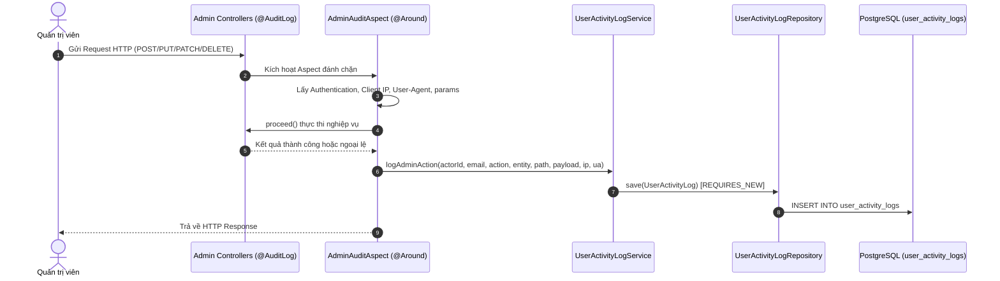

# ĐẶC TẢ KIẾN TRÚC NHẬT KÝ KIỂM TOÁN VÀ LỊCH SỬ THAO TÁC (ADMIN AUDIT & ACTIVITY LOGS)

> **Phân hệ**: Quản trị hệ thống (Admin Workspace)  
> **Phiên bản tài liệu**: 1.0  
> **Trạng thái**: Hoàn thành triển khai  
> **Đường dẫn URL**: `/admin/history` (hỗ trợ alias `/admin/logs` và `/admin/system`)  

---

## 1. Mục đích & Bối cảnh

Hệ thống ghi nhận và kiểm toán mọi thao tác trên nền tảng VieCultures nhằm 2 mục đích:
1. **Truy vết an ninh & quản trị (Admin Audit Trail)**: Ghi lại đầy đủ mọi thay đổi biến đổi dữ liệu (Create, Update, Delete, Approve, Role Change) do Quản trị viên/Biên tập viên thực hiện: Ai thực hiện, vào thời gian nào, từ IP/User-Agent nào, tác động lên thực thể nào và chi tiết thay đổi.
2. **Theo dõi tương tác học viên (Learner Telemetry / Activity)**: Giám sát tần suất đọc bài (`READER`), tra cứu từ vựng (`VOCABULARY`), khám phá bản đồ (`DISCOVERY`) và đăng nhập (`AUTH`).

---

## 2. Kiến trúc Backend (Spring Boot 3.3.4, Java 21, Spring AOP)

Hệ thống áp dụng kỹ thuật **Aspect-Oriented Programming (Spring AOP)** kết hợp Custom Annotation để tự động bắt và ghi log mà không làm ô nhiễm mã nguồn nghiệp vụ trong Controller hay Service.



### 2.1. Danh mục các tệp Backend cốt lõi

1. **Cấu hình thư viện**:
   - [`backend/pom.xml`](file:///c:/Edisk/dow/Tai_lieu/ky7/exe/viecultures/backend/pom.xml): Bổ sung `spring-boot-starter-aop`.

2. **Annotation & Aspect**:
   - [`AuditLog.java`](file:///c:/Edisk/dow/Tai_lieu/ky7/exe/viecultures/backend/src/main/java/com/viecultures/backend/annotation/AuditLog.java): Custom annotation đánh dấu method cần audit (`action`, `entity`, `description`).
   - [`AdminAuditAspect.java`](file:///c:/Edisk/dow/Tai_lieu/ky7/exe/viecultures/backend/src/main/java/com/viecultures/backend/aspect/AdminAuditAspect.java): Aspect xử lý `@Around("@annotation(auditLog)")`. Tự động:
     - Lấy danh tính từ `SecurityContextHolder` (`actorId`, `actorEmail`).
     - Lấy IP thực (hỗ trợ header `X-Forwarded-For`) và `User-Agent` từ `RequestContextHolder`.
     - Che mặt nạ (Masking) các trường nhạy cảm: `password`, `secret`, `apiKey`, `token`.
     - Đặt trong khối `try-catch` độc lập để bảo đảm lỗi ghi log không làm sập nghiệp vụ chính.

3. **Thực thể & Nghiệp vụ Log**:
   - [`UserActivityLog.java`](file:///c:/Edisk/dow/Tai_lieu/ky7/exe/viecultures/backend/src/main/java/com/viecultures/backend/entity/UserActivityLog.java): Entity ánh xạ bảng `user_activity_logs`. Đối với log quản trị, trường `eventCategory` nhận giá trị `'ADMIN_AUDIT'`, `eventType` nhận mã hành động (ví dụ: `'CREATE_POST'`).
   - [`UserActivityLogRepository.java`](file:///c:/Edisk/dow/Tai_lieu/ky7/exe/viecultures/backend/src/main/java/com/viecultures/backend/repository/UserActivityLogRepository.java): Truy vấn phân trang, tìm kiếm đa trường và nhóm thống kê.
   - [`UserActivityLogService.java`](file:///c:/Edisk/dow/Tai_lieu/ky7/exe/viecultures/backend/src/main/java/com/viecultures/backend/service/UserActivityLogService.java): Giao diện nghiệp vụ với method `logAdminAction(...)`.
   - [`UserActivityLogServiceImpl.java`](file:///c:/Edisk/dow/Tai_lieu/ky7/exe/viecultures/backend/src/main/java/com/viecultures/backend/service/impl/UserActivityLogServiceImpl.java): Triển khai `logAdminAction` sử dụng transaction riêng biệt `@Transactional(propagation = Propagation.REQUIRES_NEW)`.

4. **API Controller phục vụ tra cứu**:
   - [`AdminActivityLogController.java`](file:///c:/Edisk/dow/Tai_lieu/ky7/exe/viecultures/backend/src/main/java/com/viecultures/backend/controller/AdminActivityLogController.java):
     - `GET /api/v1/admin/activity-logs`: Lọc phân trang theo `eventType`, `eventCategory`, `search`, `fromDate`, `toDate`.
     - `GET /api/v1/admin/activity-logs/stats`: Thống kê tổng số lượng log theo từng phân loại.

5. **Các Controller Quản trị đã được gắn `@AuditLog`**:
   - [`AdminUserController.java`](file:///c:/Edisk/dow/Tai_lieu/ky7/exe/viecultures/backend/src/main/java/com/viecultures/backend/controller/AdminUserController.java): `UPDATE_USER_STATUS`, `UPDATE_USER_ROLE`.
   - [`ReadingPostController.java`](file:///c:/Edisk/dow/Tai_lieu/ky7/exe/viecultures/backend/src/main/java/com/viecultures/backend/controller/ReadingPostController.java): `CREATE_POST`, `UPDATE_POST`, `DELETE_POST`.
   - [`AdminVocabController.java`](file:///c:/Edisk/dow/Tai_lieu/ky7/exe/viecultures/backend/src/main/java/com/viecultures/backend/controller/AdminVocabController.java): `CREATE_VOCAB`, `UPDATE_VOCAB`, `DELETE_VOCAB`.
   - [`AdminAiConfigController.java`](file:///c:/Edisk/dow/Tai_lieu/ky7/exe/viecultures/backend/src/main/java/com/viecultures/backend/controller/AdminAiConfigController.java): `CREATE_KEY`, `UPDATE_KEY`, `DELETE_KEY`, `TOGGLE_KEY_ACTIVE`.
   - [`AdminSubscriptionController.java`](file:///c:/Edisk/dow/Tai_lieu/ky7/exe/viecultures/backend/src/main/java/com/viecultures/backend/controller/AdminSubscriptionController.java): `APPROVE_SUBSCRIPTION`, `REJECT_SUBSCRIPTION`, `SAVE_SUBSCRIPTION_PLAN`, `TOGGLE_PLAN_STATUS`.
   - [`AdminStorageController.java`](file:///c:/Edisk/dow/Tai_lieu/ky7/exe/viecultures/backend/src/main/java/com/viecultures/backend/controller/AdminStorageController.java): `UPLOAD_FILE`.

---

## 3. Kiến trúc Frontend (React 19, TypeScript, Tailwind CSS)

### 3.1. Danh mục các tệp Frontend cốt lõi

1. **Điều hướng & Định tuyến (Routing)**:
   - [`AdminPage.tsx`](file:///c:/Edisk/dow/Tai_lieu/ky7/exe/viecultures/frontend/src/features/admin/pages/AdminPage.tsx):
     - Khai báo kiểu `AdminTab` bổ sung `'history'`.
     - Định tuyến hợp nhất: hỗ trợ các URL `/admin/history`, `/admin/logs`, và `/admin/system` (alias tương thích ngược).
     - Xuất hàm `getTabMetadata`: cấu hình tiêu đề chuẩn *"Nhật ký kiểm toán & Lịch sử hệ thống"*, biểu tượng `History`.
     - **Tách biệt hiển thị**: Tab lịch sử chỉ hiển thị duy nhất [`AdminActivityLogView`](file:///c:/Edisk/dow/Tai_lieu/ky7/exe/viecultures/frontend/src/features/admin/components/AdminActivityLogView.tsx), không bị lẫn khối kiểm tra kết nối mạng.
   - [`AdminSidebar.tsx`](file:///c:/Edisk/dow/Tai_lieu/ky7/exe/viecultures/frontend/src/features/admin/components/AdminSidebar.tsx):
     - Cấu hình NavItem: `id: 'history'`, `aliases: ['logs', 'system']`, `fallbackLabel: 'Nhật ký & Lịch sử'`, biểu tượng `History`.

2. **Giao diện & Thành phần UI**:
   - [`AdminActivityLogView.tsx`](file:///c:/Edisk/dow/Tai_lieu/ky7/exe/viecultures/frontend/src/features/admin/components/AdminActivityLogView.tsx):
     - Thẻ KPI hiển thị số lượng sự kiện `ADMIN_AUDIT` máy chủ trả về.
     - Bộ lọc dropdown hỗ trợ nhóm sự kiện `ADMIN_AUDIT` và từng mã hành động cụ thể (`POST_CREATE`, `POST_UPDATE`, `POST_DELETE`, `USER_UPDATE`, `CONFIG_UPDATE`, `SUBSCRIPTION_APPROVE`...).
     - Lớp CSS huy hiệu màu vàng đồng Warm Heritage (`bg-amber-100 dark:bg-amber-950/60 text-amber-900 dark:text-amber-200 border-amber-400`).
     - Đầy đủ 5 trạng thái: Default, Hover/Focus viền rõ, Loading skeleton đồng kích thước, Empty thông báo rõ ràng kèm CTA, Error thông báo lỗi kèm nút thử lại.
   - [`adminActivityLogService.ts`](file:///c:/Edisk/dow/Tai_lieu/ky7/exe/viecultures/frontend/src/features/admin/services/adminActivityLogService.ts):
     - Client giao tiếp API `GET /api/v1/admin/activity-logs` và `GET /api/v1/admin/activity-logs/stats`.
     - Khai báo các interface: `ActivityLogItemDto`, `ActivityStatsSummaryDto`, `ActivityLogFilterParams`.

3. **Thành phần phụ trợ**:
   - [`AdminServiceConnections.tsx`](file:///c:/Edisk/dow/Tai_lieu/ky7/exe/viecultures/frontend/src/features/admin/components/AdminServiceConnections.tsx): Khối kiểm tra kết nối API/Database/AI, hiển thị độc lập tại Dashboard.

---

## 4. Hướng dẫn sửa đổi & Mở rộng trong tương lai

Khi cần bổ sung tính năng hoặc chỉnh sửa chức năng nhật ký, kỹ sư cần tra cứu theo các trường hợp sau:

### Trường hợp 1: Muốn gắn thêm log cho một API Admin mới
1. Mở Controller tương ứng trong `backend/src/main/java/com/viecultures/backend/controller/`.
2. Đặt annotation trên phương thức cần theo dõi:
   ```java
   @AuditLog(action = "TÊN_HÀNH_ĐỘNG", entity = "TÊN_THỰC_THỂ", description = "Mô tả ngắn gọn")
   ```
3. Hệ thống sẽ tự động bắt request, trích xuất danh tính và lưu vào CSDL mà không cần viết thêm code Service.

### Trường hợp 2: Muốn thêm bộ lọc loại sự kiện mới ở giao diện
1. Mở [`AdminActivityLogView.tsx`](file:///c:/Edisk/dow/Tai_lieu/ky7/exe/viecultures/frontend/src/features/admin/components/AdminActivityLogView.tsx).
2. Thêm thẻ `<option value="MÃ_SỰ_KIỆN">` vào dropdown lọc `selectedEventType` tương ứng trong nhóm Quản trị viên.

### Trường hợp 3: Muốn tinh chỉnh giao diện hay đường dẫn URL
- Đường dẫn & nhãn menu: chỉnh sửa tại [`AdminSidebar.tsx`](file:///c:/Edisk/dow/Tai_lieu/ky7/exe/viecultures/frontend/src/features/admin/components/AdminSidebar.tsx) và [`AdminPage.tsx`](file:///c:/Edisk/dow/Tai_lieu/ky7/exe/viecultures/frontend/src/features/admin/pages/AdminPage.tsx).
- Bảng hiển thị và chi tiết Payload: chỉnh sửa tại [`AdminActivityLogView.tsx`](file:///c:/Edisk/dow/Tai_lieu/ky7/exe/viecultures/frontend/src/features/admin/components/AdminActivityLogView.tsx).
