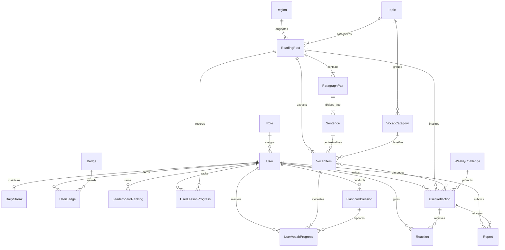

# 🏛️ Sơ Đồ Thực Thể Quan Niệm (Conceptual Data Model)

> **Dự án:** VieCultures – Nền tảng học Tiếng Anh qua Văn Hóa & Bản Sắc Việt  
> **Cấp độ kiến trúc:** Mô hình quan niệm (Conceptual Level - Chỉ thể hiện Thực thể và Mối quan hệ, lược bỏ toàn bộ thuộc tính chi tiết).  
> **Đồng bộ hóa:** Khớp hoàn toàn với yêu cầu Checkpoint 1 (CP1) và phân định rõ giữa **Phạm vi Cốt lõi MVP** và **Lộ trình Mở rộng Tương lai**.  
> **Tệp mã nguồn Mermaid đính kèm:** [`conceptual-diagram.mmd`](file:///c:/Edisk/dow/Tai_lieu/ky7/exe/viecultures/document/conceptual-diagram.mmd)

---

## 1. Giới Thiệu & Mục Đích (Purpose & Scope)

Mô hình thực thể quan niệm (**Conceptual Data Model**) phản ánh bức tranh toàn cảnh về mặt ngữ nghĩa và cấu trúc thông tin của hệ sinh thái **VieCultures**. 

Mô hình này tuân thủ các nguyên tắc:
1. **Thuần Thực thể (Entities Only):** Chỉ thể hiện các thực thể nghiệp vụ và mối liên kết logic giữa chúng; không đưa thuộc tính chi tiết (Attributes) vào sơ đồ để giữ góc nhìn kiến trúc sáng sủa và tập trung.
2. **Phân định rõ Phạm vi MVP và Lộ trình Mở rộng:** Tách bạch các thực thể phục vụ 4–5 tính năng cốt lõi của Web MVP (bài đọc song ngữ, tra/lưu từ vựng, flashcard, tiến độ, khám phá vùng miền) và các thực thể dành cho giai đoạn sau (cảm nghĩ cộng đồng, gamification).
3. **Hiện thực hóa Trải nghiệm Khách hàng (Persona Minh, 20 tuổi):** Đảm bảo luồng dữ liệu phục vụ học tập tự nhiên theo ngữ cảnh mà không bị đứt mạch do tra từ điển ngoài.

---

## 2. Sơ Đồ Thực Thể Quan Niệm (Mermaid Conceptual Diagram)



---

## 3. Phân Loại Các Thực Thể Theo Phạm Vi Triển Khai

```
┌────────────────────────────────────────────────────────────────────────┐
│                        HỆ SINH THÁI VIECULTURES                        │
├───────────────────────────────────┬────────────────────────────────────┤
│ 🟢 PHẠM VI CỐT LÕI MVP            │ 🔵 LỘ TRÌNH MỞ RỘNG (POST-MVP)     │
│ (Core Web MVP Entities)           │ (Future Roadmap Entities)          │
├───────────────────────────────────┼────────────────────────────────────┤
│ • User (Người học)                │ • UserReflection (Cảm nghĩ UGC)    │
│ • Role (Vai trò hệ thống)         │ • Reaction (Thả tim động viên)     │
│ • Region (Vùng miền / Địa phương) │ • Report (Báo cáo vi phạm nội dung)│
│ • Topic (Chủ đề văn hóa)          │ • WeeklyChallenge (Thử thách tuần) │
│ • ReadingPost (Bài đọc song ngữ)  │ • DailyStreak (Chuỗi ngày học)     │
│ • ParagraphPair (Cặp đoạn 1:1)    │ • Badge (Huy hiệu vinh danh)       │
│ • Sentence (Câu & Mốc âm thanh)   │ • UserBadge (Ghi nhận đạt huy hiệu)│
│ • VocabCategory (Nhóm từ vựng)    │ • LeaderboardRanking (BXH tuần)    │
│ • VocabItem (Từ vựng ngữ cảnh)    │                                    │
│ • UserLessonProgress (Tiến độ bài)│                                    │
│ • UserVocabProgress (Tiến độ từ)  │                                    │
│ • FlashcardSession (Phiên ôn thẻ) │                                    │
└───────────────────────────────────┴────────────────────────────────────┘
```

### 3.1. Nhóm Thực Thể Cốt Lõi MVP (Core MVP Entities)
1. **`User` (Người dùng / Học viên):** Đại diện cho người học tiếng Anh (độ tuổi 18–25, CEFR A2–B2, tiêu biểu như Persona Minh).
2. **`Role` (Vai trò hệ thống):** Phân quyền người dùng (Học viên, Quản trị viên, Biên tập viên nội dung).
3. **`Region` (Vùng miền / Địa phương):** Đại diện cho 54 tỉnh thành / các vùng văn hóa (Bắc Bộ, Trung Bộ, Nam Bộ, Tây Nguyên...), phục vụ tính năng gợi ý và khám phá ẩm thực, phong tục địa phương.
4. **`Topic` (Chủ đề văn hóa):** Các trục nội dung lớn: Ẩm thực, Di sản & Lịch sử, Lễ hội, Lối sống phong tục.
5. **`ReadingPost` (Bài đọc song ngữ):** Bài học văn hóa song ngữ được phân cấp theo CEFR (A2, B1, B2).
6. **`ParagraphPair` (Cặp đoạn văn song ngữ):** Cấu trúc bài đọc đối xứng nghiêm ngặt 1:1 gồm đoạn văn chính tiếng Anh và đoạn dịch tiếng Việt hỗ trợ, duy trì mạch đọc liền mạch.
7. **`Sentence` (Câu đơn ngữ cảnh & Mốc âm thanh):** Đơn vị câu được bóc tách từ bài đọc, có gắn timestamp audio phục vụ luyện nghe câu và nhại giọng (Shadowing).
8. **`VocabCategory` (Danh mục từ vựng):** Nhóm chuyên đề của từ vựng (Kiến trúc cổ, Ẩm thực đường phố, Lễ nghi truyền thống...).
9. **`VocabItem` (Từ vựng học thuật ngữ cảnh):** Thực thể từ vựng độc lập được trích xuất từ bài đọc. **Bắt buộc** phải gắn với câu ngữ cảnh gốc (`context_sentence`).
10. **`UserLessonProgress` (Tiến độ bài học):** Ghi nhận trạng thái hoàn thành bài học của người dùng.
11. **`UserVocabProgress` (Tiến độ từ vựng):** Quản lý trạng thái ghi nhớ của từng từ đối với người học (Đã nhớ / Cần ôn lại).
12. **`FlashcardSession` (Phiên ôn Flashcard):** Phiên ôn tập chủ động 2 mặt, kích hoạt việc cập nhật trạng thái ghi nhớ cho từ vựng.

### 3.2. Nhóm Thực Thể Lộ Trình Mở Rộng (Post-MVP / Roadmap Entities)
13. **`UserReflection` (Bài viết cảm nghĩ cộng đồng):** Không gian tự do viết cảm nghĩ không chấm điểm / không phán xét ngữ pháp.
14. **`Reaction` (Tương tác cảm xúc):** Lượt thả tim khích lệ bài viết của bạn học.
15. **`Report` (Báo cáo vi phạm):** Cơ chế báo cáo bài viết vi phạm thuần phong mỹ tục hoặc nội dung nhạy cảm.
16. **`WeeklyChallenge` (Thử thách viết tuần):** Chủ đề tuần do ban biên tập phát động để định hướng bài viết cảm nghĩ.
17. **`DailyStreak` (Chuỗi ngày học liên tục):** Đếm ngày học hợp lệ để duy trì thói quen học tập.
18. **`Badge` (Huy hiệu vinh danh):** Các danh hiệu phần thưởng thành tích văn hóa.
19. **`UserBadge` (Huy hiệu đã đạt):** Bản ghi chứng nhận huy hiệu mà người dùng đã mở khóa.
20. **`LeaderboardRanking` (Bảng xếp hạng tuần):** Xếp hạng thi đua điểm kinh nghiệm (EXP) hàng tuần.

---

## 4. Bảng Phân Tích Mối Quan Hệ Nghiệp Vụ (Relationships Semantics)

| Thực thể gốc (Source) | Bản số | Thực thể đích (Target) | Nhãn quan hệ | Ý nghĩa nghiệp vụ & Quy tắc liên kết |
| :--- | :---: | :--- | :---: | :--- |
| `Role` | $1 - N$ | `User` | `assigns` | Một vai trò được gán cho nhiều người dùng. |
| `Region` | $1 - N$ | `ReadingPost` | `originates` | Một vùng miền/tỉnh thành có nhiều bài đọc giới thiệu về ẩm thực và di sản địa phương (**Slide 3 - CP1**). |
| `Topic` | $1 - N$ | `ReadingPost` | `categorizes` | Một chủ đề văn hóa bao gồm nhiều bài đọc theo trình độ A2–B2 (**BR-01.1**). |
| `Topic` | $1 - N$ | `VocabCategory` | `groups` | Một chủ đề văn hóa lớn bao quát các nhóm danh mục từ vựng chuyên ngành (**BR-02.4**). |
| `ReadingPost` | $1 - N$ | `ParagraphPair` | `contains` | Một bài đọc bao gồm danh sách các cặp đoạn văn song ngữ Anh - Việt đối sánh 1:1 (**BR-01.2**). |
| `ParagraphPair` | $1 - N$ | `Sentence` | `divides_into` | Cặp đoạn văn được chia nhỏ thành các câu có timestamp audio phục vụ luyện nghe câu (**BR-01.4**). |
| `ReadingPost` | $1 - N$ | `VocabItem` | `extracts` | Hệ thống trích xuất các từ vựng học thuật trọng tâm từ bài đọc (**BR-02.1**). |
| `Sentence` | $1 - N$ | `VocabItem` | `contextualizes` | Câu trong bài đọc cung cấp ngữ cảnh gốc bắt buộc (`context_sentence`) cho từ vựng (**BR-02.2**). |
| `VocabCategory` | $1 - N$ | `VocabItem` | `classifies` | Mỗi từ vựng được xếp vào danh mục chủ đề để phục vụ tra cứu chuyên đề (**BR-02.3**). |
| `User` | $1 - N$ | `UserLessonProgress` | `tracks` | Người dùng theo dõi tiến trình học từng bài đọc (**BR-05**). |
| `ReadingPost` | $1 - N$ | `UserLessonProgress` | `records` | Một bài đọc ghi nhận tiến độ của nhiều người dùng. |
| `User` | $1 - N$ | `UserVocabProgress` | `masters` | Người dùng tích lũy trạng thái ghi nhớ cho từng từ vựng học thuật. |
| `VocabItem` | $1 - N$ | `UserVocabProgress` | `evaluates` | Một từ vựng được đo lường mức độ ghi nhớ qua nhiều học viên. |
| `User` | $1 - N$ | `FlashcardSession` | `conducts` | Người dùng thực hiện các phiên lật thẻ ôn tập Flashcard (**BR-04**). |
| `FlashcardSession` | $1 - N$ | `UserVocabProgress` | `updates` | Mỗi phiên ôn tập cập nhật trạng thái *Đã nhớ / Cần ôn lại*. |
| `ReadingPost` | $1 - N$ | `UserReflection` | `inspires` | Bài đọc tạo nguồn cảm hứng để người học viết bài cảm nghĩ (**BR-03.1**). |
| `User` | $1 - N$ | `UserReflection` | `writes` | Người dùng tạo bài viết chia sẻ suy nghĩ cá nhân. |
| `UserReflection` | $N - M$ | `VocabItem` | `references` | Người dùng chèn từ vựng vào bài viết và hệ thống tự động nhận diện từ vựng học thuật (**BR-03.4**). |
| `User` | $1 - N$ | `Reaction` | `gives` | Người dùng thả tim khích lệ bài cảm nghĩ của bạn học. |
| `UserReflection` | $1 - N$ | `Reaction` | `receives` | Bài cảm nghĩ nhận được các lượt thả tim từ cộng đồng (**BR-03.3**). |
| `User` | $1 - N$ | `Report` | `submits` | Người học báo cáo bài viết có nội dung vi phạm. |
| `UserReflection` | $1 - N$ | `Report` | `receives` | Bài viết vi phạm bị gắn cờ để chờ kiểm duyệt thụ động. |
| `WeeklyChallenge` | $1 - N$ | `UserReflection` | `prompts` | Thử thách tuần định hướng đề tài cho bài cảm nghĩ (**BR-06.4**). |
| `User` | $1 - 1$ | `DailyStreak` | `maintains` | Mỗi người dùng duy trì chuỗi ngày học liên tục (**BR-06.1**). |
| `User` | $1 - N$ | `UserBadge` | `earns` | Người dùng tích lũy các huy hiệu thành tích sau các mốc học tập. |
| `Badge` | $1 - N$ | `UserBadge` | `awards` | Một loại huy hiệu có thể trao tặng cho nhiều học viên đạt chuẩn. |
| `User` | $1 - N$ | `LeaderboardRanking` | `ranks` | Người dùng được xếp hạng trên bảng thi đua EXP hàng tuần (**BR-06.3**). |

---

## 5. Hướng Dẫn Sử Dụng & Xuất Bản Sơ Đồ

- **Mở xem và chỉnh sửa sơ đồ:** Mở tệp [`conceptual-diagram.mmd`](file:///c:/Edisk/dow/Tai_lieu\ky7\exe\viecultures\document\conceptual-diagram.mmd) trên Mermaid Live Editor (`mermaid.live`), VS Code hoặc Obsidian.
- **Tài liệu tham khảo liên quan:**
  - [Slide thuyết trình Checkpoint 1 (14 slides)](file:///c:/Edisk/dow/Tai_lieu\ky7\exe\viecultures\document\presentation.md)
  - [Từ điển dữ liệu hệ thống (Data Dictionary)](file:///c:/Edisk/dow/Tai_lieu\ky7\exe\viecultures\document\04-agent-and-dev-guidelines\system-data-dictionary.md)
  - [Quy tắc nghiệp vụ cốt lõi (BR-01 đến BR-06)](file:///c:/Edisk/dow/Tai_lieu\ky7\exe\viecultures\document\02-business-rules/)
