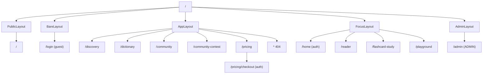

# Frontend Routes – Đề xuất chuẩn hoá (Proposal)

> Dựa trên hiện trạng ở [frontend-routes.md](./frontend-routes.md). **Chỉ là đề xuất, chưa sửa code.**

## 0. Quyết định đã chốt (2026-10-16)

| # | Câu hỏi | Quyết định |
|---|---------|-----------|
| 1 | Đổi tên URL hay dọn? | **Giữ tên URL hiện tại**, chỉ dọn alias & bất nhất |
| 2 | `/home` cần đăng nhập? | **Có** |
| 3 | Nguồn role admin | **JWT claim** |
| 4 | URL thanh toán | **`/pricing/checkout`** |

---

## 1. Nguyên tắc

1. **Một trang = một URL canonical**, có nghĩa (không `-1`, `-2`).
2. **Một nguồn sự thật**: toàn bộ URL khai báo trong `frontend/src/routes/paths.ts` (hằng số + hàm build URL). Cấm hard-code chuỗi URL trong component.
3. **Một cách điều hướng**: `react-router-dom` (`<Link to>` / `useNavigate`). Bỏ "view name", bỏ custom event `app:navigate`/`app-navigate`, bỏ custom `components/Link.tsx`.
4. **Một tên param cho một khái niệm** (xem mục 2.1).
5. **Layout theo route** (nested routes + `<Outlet>`), không dùng chuỗi `activeView !== ...`.
6. **Guard theo route**: public / cần đăng nhập / cần role ADMIN (đọc từ JWT).
7. URL cũ **giữ redirect** một thời gian để không vỡ link/bookmark.

---

## 2. Bảng URL chuẩn

| Trang | URL canonical | Thay đổi so với hiện tại | Layout | Guard |
|-------|---------------|--------------------------|--------|-------|
| Landing | `/` | – | `PublicLayout` | public |
| Đăng nhập | `/login?redirect=` | – | `BareLayout` | chỉ khách (đã login → `/home`) |
| Dashboard | `/home` | thêm guard | `FocusLayout` | **đăng nhập** |
| Khám phá | `/discovery` | – | `AppLayout` | public |
| Đọc bài | `/reader?postId=&level=&mode=` | chuẩn hoá param | `FocusLayout` | public |
| Kho từ vựng | `/dictionary` | – | `AppLayout` | public |
| Ôn flashcard | `/flashcard-study?postId=&level=&saved=1` | chuẩn hoá param | `FocusLayout` (Navbar, không Footer – giữ như cũ) | public |
| Cộng đồng | `/community` | – | `AppLayout` | public |
| Cuộc thi | `/community-contest` | **đảo**: hiện canonical là `/community-2` | `AppLayout` | public |
| AI Playground | `/playground?postId=&topic=&level=` | chuẩn hoá param | `FocusLayout` | public |
| Bảng giá | `/pricing` | – | `AppLayout` | public |
| Thanh toán | `/pricing/checkout` | **đảo**: hiện canonical là `/checkout` | `AppLayout` | **đăng nhập** |
| Quản trị | `/admin` | thêm guard | `AdminLayout` | **role ADMIN (JWT)** |
| 404 | `*` → `NotFoundPage` | mới (hiện → `/`) | `AppLayout` | public |

### 2.1 Chuẩn query param

| Khái niệm | Chuẩn | Thay thế cho |
|-----------|-------|--------------|
| Bài viết | `postId` | `id`, `story`, `article`, `deck` |
| Cấp độ | `level` | (giữ) |
| Chế độ đọc | `mode=bilingual\|extensive` | (giữ) |
| Chỉ từ đã lưu | `saved=1` | (giữ) |
| Quay lại sau login | `redirect` (chỉ nhận path nội bộ bắt đầu bằng `/`, không `//`) | (giữ) |

- Trong giai đoạn chuyển tiếp, page vẫn **đọc fallback** các tên cũ, nhưng mọi nơi **tạo** URL chỉ dùng `postId`.
- Default ngầm (`tet-holiday` / `imperial-hue`): bỏ; thiếu `postId` → chuyển `/discovery`. *(Cần xác nhận nếu muốn giữ bài demo.)*

### 2.2 Guard & JWT

- `RequireAuth`: chưa đăng nhập → `/login?redirect=<path hiện tại>`.
- `RequireRole("ADMIN")`: decode JWT (claim role/roles), sai role → 404 hoặc `/home`.
- Thông tin user/role đọc từ một nơi duy nhất (`auth-storage` / auth context), thay cho state `user`/`isLoggedIn` trong `App.tsx` + event `auth:change`.
- Sau login: luôn `navigate(redirect || '/home', { replace: true })` — bỏ `window.location.href` và `navigate(-1)`.

---

## 3. Redirect giữ tương thích (`routes/legacy-redirects.tsx`)

| URL cũ | → URL chuẩn |
|--------|-------------|
| `/landing` | `/` |
| `/bilingual-reader`, `/learning-loop`, `/loop` (+query) | `/reader` (+query) |
| `/extensive-reader` (+query) | `/reader?…&mode=extensive` (luôn thêm mode) |
| `/flashcard-library` | `/dictionary` |
| `/flashcards`, `/flashcard-study-page` | `/flashcard-study` |
| `/community-1` | `/community` |
| `/community-2` | `/community-contest` |
| `/subscription`, `/upgrade` | `/pricing` |
| `/checkout` | `/pricing/checkout` |
| `/admin/posts` | `/admin` |

---

## 4. Cấu trúc code

```
frontend/src/routes/
  paths.ts              // PATHS + builders: paths.reader({postId, level, mode}), paths.flashcardStudy({...})
  router.tsx            // <Routes> nested theo layout
  guards.tsx            // RequireAuth, RequireRole, GuestOnly
  legacy-redirects.tsx
frontend/src/layouts/
  PublicLayout.tsx  AppLayout.tsx  FocusLayout.tsx  BareLayout.tsx  AdminLayout.tsx
```



---

## 5. Lộ trình (mỗi bước build xanh được)

| Bước | Việc |
|------|------|
| 1 | Tạo `paths.ts`, thay toàn bộ URL hard-code (~40 chỗ) bằng `PATHS`/builder; sửa chỗ còn dùng alias (`/bilingual-reader`…) |
| 2 | Bỏ view-name + custom event + custom `Link.tsx`; xoá `handleNavigate`, `getActiveView` |
| 3 | Tách layouts + nested routes, xoá điều kiện `activeView` |
| 4 | Guards (JWT) + `NotFoundPage` + gom logic login redirect |
| 5 | Đảo canonical `/community-contest`, `/pricing/checkout`; chuẩn param `postId`; thêm `legacy-redirects.tsx` |
| 6 | Sau 1–2 release: xoá legacy redirects & fallback param cũ |
