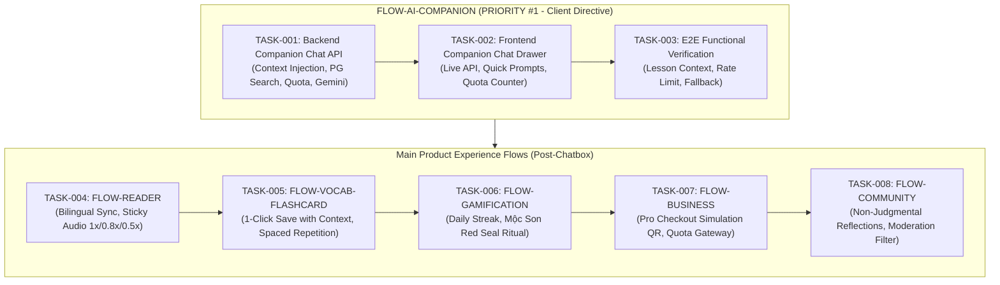

# Codebase Gap Analysis & Architecture Audit Report

**Project:** VieCultures (*"Learn the language. Tell the culture."*)  
**Audit Date:** 2026-10-25  
**Harness Protocol:** Phase 1 - Gap Analysis Gate  
**Stakeholder Directive (Highest Priority):** Đảm bảo chức năng chatbox hoạt động tốt. Ưu tiên bốc và hoàn thiện luồng chatbox trước tiên. Sau khi hoàn thành mới làm các tính năng khác bám theo main flow.

---

## 1. Executive Summary

This codebase gap analysis benchmarks the active source code across **`backend/src`** (Spring Boot 3.3.4, Java 17), **`frontend/src`** (React 19, Vite 6, Tailwind CSS 4), and **`mobile/`** (Expo React Native) against the architectural blueprints, domain contracts, and SSOT constants documented in **`document/`** (`docs/`).

### Verification Baseline
- **Backend Build & Verification:** `mvn test-compile` compiles cleanly (83 source files, 4 test files, 0 errors).
- **Frontend Build & Verification:** `npm run build` (`check:palette`, `tsc -b`, `vite build`) bundles cleanly (3,151 modules transformed, 0 TypeScript errors).
- **Mobile Verification:** Expo React Native codebase inspected.

### Critical Finding (Chatbox Prioritization)
The previous project task board (`BOARD.md`) recorded `FLOW-AI-COMPANION` as completed. However, a deep codebase audit reveals:
1. **Backend Gap:** Neither `CompanionChatController`, `CompanionChatService`, nor the required request/response DTOs exist in `backend/src`. The Spring Boot backend currently has TTS and voice endpoints, but **zero chat endpoints**.
2. **Frontend Gap:** The existing `FloatingAiCompanionWidget.tsx` in `frontend/src/features/reader/components/` is purely a static stub containing the hardcoded response:  
   *`"Live AI replies are not connected in this preview yet."`*  
   Furthermore, non-pro users are blocked completely, violating the requirement in `system_constants.md` and `context_retrieval_chat.md` allowing 3 free turns per day (`TIER_FREE`).
3. **Action:** Per Client Directive, `FLOW-AI-COMPANION` is reset to **ACTIVE / READY** status in `BOARD.md` and `backlog/`. Its tasks are restored to executable state so that Phase 2 can immediately begin implementing the backend companion chat API (`TASK-001`).

---

## 2. Domain-by-Domain Gap Analysis Matrix

| Domain Folder | Contract / Spec Reference | Current Backend Implementation | Current Frontend Implementation | Mobile Implementation | Status & Severity |
| :--- | :--- | :--- | :--- | :--- | :--- |
| **`03_domain_ai_companion`** | `interface_ai_companion.md` `context_retrieval_chat.md` `conversational_flows.md` `fallback_mechanisms.md` | **0% implemented.** Missing `CompanionChatController`, `CompanionChatService`, context injection from `ReadingPost`/`ParagraphPair`, Postgres search query, daily free quota limit (3 turns). | Static placeholder widget (`FloatingAiCompanionWidget.tsx`) with canned text. Direct Gemini call exists in playground map (`geminiMapAiService.ts`) but is isolated from reader lessons. | Mock `setTimeout` simulator in `companion.tsx`. Blocks non-pro. | 🔴 **CRITICAL GAP (Client Priority #1)** |
| **`00_core`** | `system_constants.md` `system_data_dictionary.md` `interface_learning_loop.md` `edge_cases_and_validation.md` | Auth (JWT, Google OAuth, Admin, Email OTP, HikariCP, PostgreSQL DB setup) fully implemented. | Auth routes, Login, Register, Profile, Admin page, theme token system fully implemented. | Basic token storage and session handling. | 🟡 **LOW GAP** (Need to persist daily chat quota counters). |
| **`01_domain_reader`** | `interface_reader.md` `paragraph_pairing.md` `natural_audio_dictation.md` `editorial_guidelines.md` | `ReadingPostController`, `ReadingPostService`, entities `ReadingPost`, `ParagraphPair`, `VocabItem`. Azure & Gemini TTS generation working. | Reader page (`/reader/:id`), bilingual 1:1 paragraph pairing, sticky audio controls, dictation & shadowing workspace in playground. | Reader post viewer screen. | 🟢 **COMPLIANT / MINOR REFINEMENTS** |
| **`02_domain_vocab_flashcards`** | `interface_vocab.md` `context_extraction.md` `spaced_repetition.md` | `VocabController`, `UserVocabProgressRepository`, dictionary lookup service. | Flashcards study session (`/flashcards`), 2-sided card flip, Leitner binary rating (🟢/🔴), 1-click save. | Basic vocab listing. | 🟢 **COMPLIANT** (Enforce mandatory context sentence persistence). |
| **`04_domain_speaking_voice`** | `interface_speaking.md` `pronunciation_feedback.md` | `GeminiVoiceService`, `VoiceController`, `AzureSpeechService`. | Web Speech recording, shadowing practice panels, sentence recorder hooks. | Audio recording stub. | 🟢 **COMPLIANT** |
| **`05_domain_gamification`** | `interface_gamification.md` `habit_tracking.md` | Basic User entity fields for streak/activity. | Daily streak badge, Mộc Son Red Seal visual stamp and ritual animations. | Streak badge UI. | 🟡 **MEDIUM GAP** (Server-side streak sync endpoint). |
| **`06_domain_community`** | `interface_community.md` `reflections_moderation.md` | `UserReflection` entity & repository. | Community reflections feed and submission modal in reader. | Basic reflections list. | 🟡 **MEDIUM GAP** (Passive moderation keyword filter in backend). |
| **`07_domain_startup_business`** | `interface_business.md` `financial_model_cogs.md` `market_validation.md` | User roles (`ROLE_USER`, `ROLE_PRO`, `ROLE_ADMIN`). | Pricing page (`/pricing`), Checkout page with QR mock, local storage Pro toggle. | Pricing screen with mock upgrade. | 🟢 **COMPLIANT FOR DEMO / CP4** |

---

## 3. Detailed Chatbox Gap Breakdown (`FLOW-AI-COMPANION`)

To satisfy the **Client Directive**, the following specific components must be engineered:

### 3.1 Backend Components Required
1. **DTOs:**
   - `CompanionChatRequest`: fields `lessonId` (UUID string, optional), `message` (String, required), `history` (List of ChatMessage objects).
   - `CompanionChatResponse`: fields `reply` (String), `suggestedPrompts` (List<String>), `referencedLessons` (List<ReferencedLessonDto>), `remainingDailyTurns` (Integer).
   - `ReferencedLessonDto`: `id` (String), `title` (String), `topic` (String).
2. **Repository Query:**
   - In `ReadingPostRepository`: add search method matching `titleEn`, `titleVi`, `topic`, or `summary` for Global Cultural Chat mode.
3. **Service Layer (`CompanionChatService` & `CompanionChatServiceImpl`):**
   - **Lesson-Scoped Mode:** When `lessonId` is present, fetch `ReadingPost` and paragraphs; build structured prompt with cultural and linguistic grounding.
   - **Global Search Mode:** When `lessonId` is null, search PostgreSQL `reading_posts`; inject top matched posts into prompt or trigger graceful fallback per `fallback_mechanisms.md`.
   - **Quota Enforcement:** Enforce maximum 3 requests/day for `TIER_FREE` users. Return `403 Forbidden` with error code `LIMIT_EXCEEDED` when quota is exhausted. Pro users receive unlimited turns.
   - **Gemini Integration:** Connect to Google Gemini API (`gemini-2.5-flash` or `gemini-3.8-flash`) using existing `RestTemplate` and structured configuration.
4. **Controller Layer (`CompanionChatController`):**
   - Expose `POST /api/v1/companion/chat`.

### 3.2 Frontend Components Required
1. **API Service (`companionService.ts`):**
   - Strongly typed client calling `POST /api/v1/companion/chat`.
2. **Interactive UI (`CompanionChatDrawer.tsx`):**
   - Replace the mock responses with real dynamic chat exchange.
   - Support conversation message history, quick prompt action chips, referenced lesson links, and remaining turn indicator.
   - Display upgrade modal / prompt when daily quota is depleted.
3. **Global Integration:**
   - Mount launcher button in Reader (`/reader/:id`) with auto-passed `lessonId`, and global navbar for general exploration.

---

## 4. Vertical Slice Execution Roadmap

---

## 5. Next Action Under Harness Protocol

With this Gap Analysis completed and verified against the live codebase:
- `docs/tasks/backlog/` is populated with vertical slice tickets.
- `docs/tasks/BOARD.md` is updated to reflect accurate ticket states.
- The harness **TERMINATES** immediately in accordance with Phase 1 rules.
- In Phase 2, the squad will pick **`TASK-001`** (Backend AI Companion Chat API) from `docs/tasks/backlog/FLOW-AI-COMPANION/` and execute.
